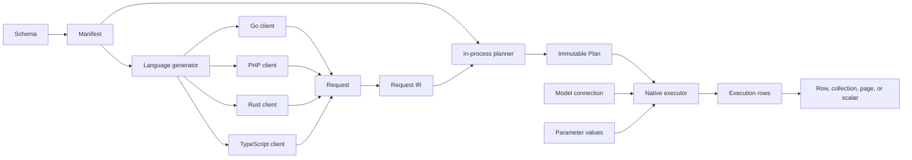
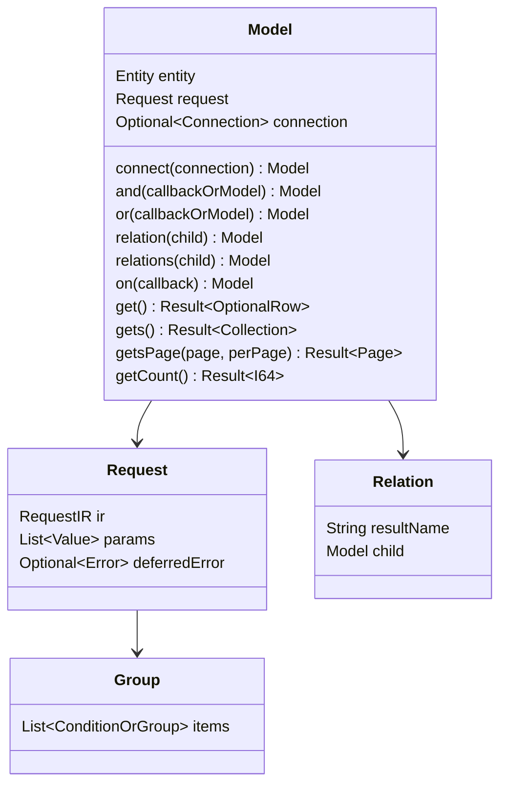
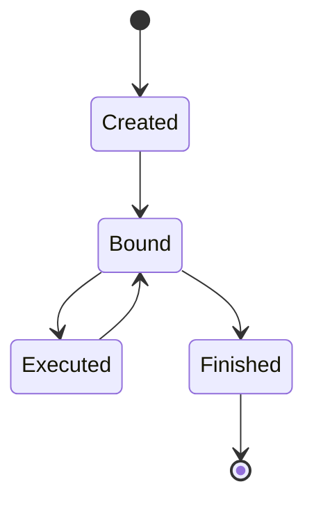
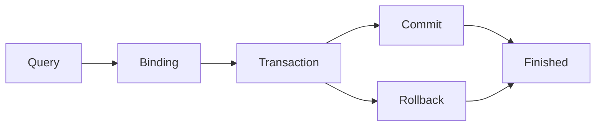
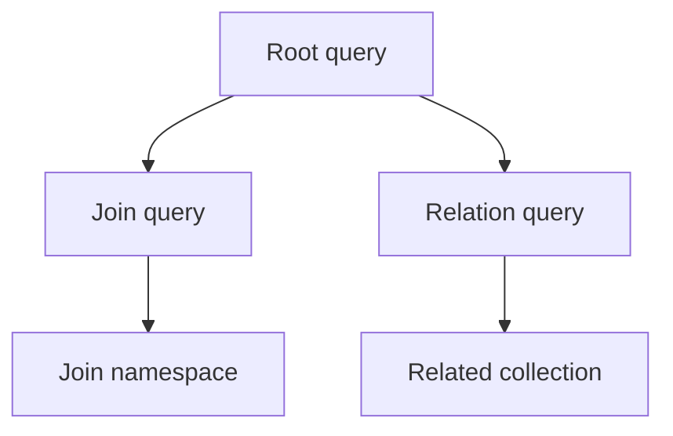
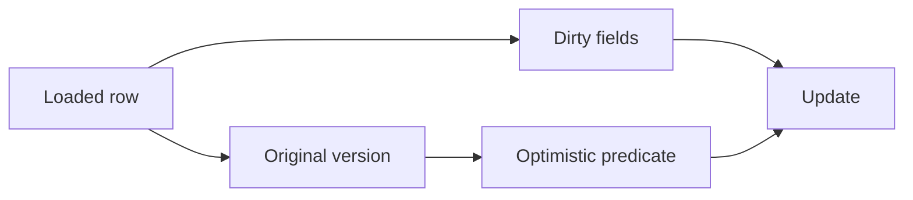
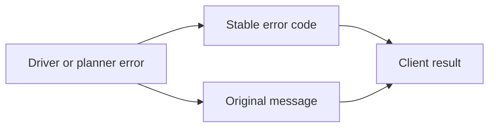
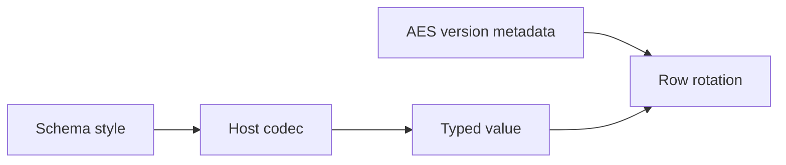

<!-- doc-id: interfaces -->
<!-- source-sha256: 396fb69575258cca2161ed2d9e83ef0e5bc387d86fdb8247acb4b0a4dafcf29a -->
# 공통 인터페이스 v1

이 문서는 [DSL](dsl.md) 문법의 공통 공개 자료구조, 소유 규칙, 상태 전이, 클라이언트 호출 순서를 정의한다. 구현 상태는 [구현 대조표](../operations/interface-implementation.md)에 기록한다. 인터페이스를 정의했다는 사실이 모든 클라이언트의 구현을 입증하지는 않는다.

## 1. 호출 구간과 변경 규칙

스키마 매니페스트는 엔티티, 필드, 연산자, 스타일, 오류를 정의한다. 각 언어는 자기 빌드 도구로 매니페스트에서 모델을 생성한다. 클라이언트 라이브러리는 타입이 있는 요청 형태를 검증하고 호출한 프로세스 안에서 변경할 수 없는 Plan으로 계획한다. 실행기는 Plan, 매개변수 값, 모델에 선택된 연결을 받는다.

변경 순서는 설계 계획과 DSL 갱신, 매니페스트와 생성물 갱신, 모든 클라이언트 갱신, 공통 벡터 실행, 쌍 문서 갱신이다. 클라이언트는 공통 인터페이스를 맞추기 위해 비공개 필드나 다른 호출 순서를 추가할 수 없다.

## 2. 모듈 호출 흐름 — IF-01

플래너는 데이터베이스 인증 정보와 매개변수 값을 받지 않는다. 데이터베이스 접근은 실행기의 책임이다. 모델은 `connect`로 연결을 받는다. 트랜잭션 콜백 안에서 `connect`를 호출하지 않은 모델은 현재 실행 흐름의 활성 트랜잭션을 사용한다. `connect`를 호출하지 않은 조인·관계 자식은 부모 연결을 사용한다.

## 3. 자료형과 값 — IF-02

- **INT-1** `I64` — Go: `int64`; PHP: `int`; Rust: `i64`; TypeScript: `number`; Python: `int`
- **INT-2** `F64` — Go: `float64`; PHP: `float`; Rust: `f64`; TypeScript: `number`; Python: `float`
- **INT-3** `Bool` — Go: `bool`; PHP: `bool`; Rust: `bool`; TypeScript: `boolean`; Python: `bool`
- **INT-4** `Text` — Go: `string`; PHP: `string`; Rust: `String`; TypeScript: `string`; Python: `str`
- **INT-5** `Bytes` — Go: `[]byte`; PHP: `string`; Rust: `Vec<u8>`; TypeScript: `Uint8Array`; Python: `bytes`
- **INT-6** `DateTime` — Go: `time.Time`; PHP: `DateTimeImmutable`; Rust: `NaiveDateTime`; TypeScript: interface 값은 `Date` (generated model getter는 DBS-112의 canonical dbspec text인 `string`을 반환하고 setter는 text를 받음; DBS-121); Python: `str`
- **INT-7** `StyledValue`, value codec이 있는 column의 field로 SQL NULL이나 decode된 값을 담는다 — Go: `orm.StyledValue`; PHP: `\Polyspec\Orm\StyledValue`; Rust: `polyspec_orm::StyledValue<T>`, `T`는 codec의 decode type; TypeScript: `StyledValue<T>`; Python: `StyledValue`
- **INT-8** `Optional<T>` — Go: `*T`; PHP: `?T`; Rust: `Option<T>`; TypeScript: `T | null`; Python: `T | None`
- **INT-9** `List<T>` — Go: slice; PHP: array; Rust: `Vec<T>`; TypeScript: `T[]`; Python: `list`
- **INT-10** `Result<T>` — Go: `(T, error)`; PHP: 반환 또는 예외; Rust: `Result<T>`; TypeScript: `Promise<T>`; Python: 반환 또는 예외
- **INT-11** `Key` — Go: `orm.Key`; PHP: `int|string|bool|Bytes|DateTimeInterface`; Rust: `polyspec_orm::Key`; TypeScript: `Key`; Python: `Key` (`int | str | bool | bytes | datetime.datetime`). Python `Collection.keys()`는 지원하는 각 키의 타입을 보존하고 이 키 타입에 속하지 않는 값은 거부한다. `datetime` column의 key는 구성 요소가 하나든 여럿이든 모든 구현에서 그 순간의 date and time이며 column의 text가 아니다. TypeScript `Date`는 millisecond까지만 담으므로 그 key는 값이 millisecond로 자른 순간이고 `toJSON()`이 소수부의 끝 0이 없는 UTC RFC 3339로 순간 전체를 돌려주는 `Date`다. 한 millisecond 안의 두 microsecond는 다른 key이며, 그런 key는 `keys()`가 돌려준 key로 찾는다. 호출자가 만든 `Date`는 자기 millisecond의 key다.

null, 빈 목록, 누락 필드, 기본값은 서로 다른 상태다. 직렬화는 코덱 명세가 요구하는 논리 타입과 필드 순서를 유지한다.

## 4. 모델과 조건 트리 — IF-03 ~ IF-08

모델은 쿼리 빌더이자 조회한 행 타입이다. 묶음은 조건이나 하위 묶음을 순서대로 가지며 첫 항목 뒤의 항목은 명시적인 `AND` 또는 `OR` 연결자를 가진다. `and(fn)`과 `or(fn)`은 하위 묶음을 만들며 콜백은 같은 타입의 빈 모델을 받고, `not(fn)`, `andNot(fn)`, `orNot(fn)`은 부정 묶음(`NOT (…)`)을 만든다. `and(model)`과 `or(model)`은 조인 자식의 조건을 묶음으로 넣는다. 조인 `ON` 조건은 `WHERE` 조건과 따로 저장한다.

종단 작업은 저장된 요청을 바꾸지 않으므로 종단 작업을 반복해도 같은 SQL 문장을 만든다.

- **INT-88** 생성된 모델의 query base(Go `Core`, PHP `Model`, TypeScript `Core`, Python `Core`)는 요청마다 builder 호출이 기록한 첫 오류를 보관한다. 종단 작업은 어떤 statement도 보내기 전에 그 오류를 반환한다. 빈 목록(DSL-47) 같은 condition 값의 거부도 그런 오류이며, chain 호출은 그것을 던지지 않고 기록한다.

## 5. 공개 API — IF-09 ~ IF-12

### 5.0 연결 입력

모든 공개 클라이언트는 DSN URI 하나를 받는다. `mysql://`, `postgres://`, `sqlite://`가 데이터베이스 드라이버를 선택한다. 모든 연결은 datetime 값을 UTC로 읽고 쓰며, 선택 매개변수 `timezone`은 `UTC`나 `+00:00`만 받는다. 호출자는 별도 드라이버 값을 전달하지 않는다.

- **INT-12** `github.com/polyspec/orm/packages/go` Go 모듈 — 공개 연결 호출: `model.Connect(dsn, config)`; 결과: `(*orm.DB, error)`
- **INT-13** `polyspec/orm` PHP client — 공개 연결 호출: `\Polyspec\Orm\Tests\Model\connect(dsn, new Config(…))`; 결과: `Db`
- **INT-14** `polyspec-orm` Rust crate — 공개 연결 호출: `model::connect(dsn, pool_size, config).await?`; 결과: `polyspec_orm::Db`
- **INT-15** `@polyspec/orm` TypeScript package — 공개 연결 호출: generated module의 `connect(dsn, options)`; 결과: `Promise<Db>`

### 5.1 생성과 언어별 표기

- **INT-16** 모델 생성 — PHP: `new Product`; Go: `model.Product()`; Rust: `Product::new()`; TypeScript: `new Product()`; Python: `Product()`
- **INT-17** 연결 — PHP: `->connect($db)` 또는 `($db)`; Go: `.Connect(db)`; Rust: `.connect(&db)`; TypeScript: `.connect(db)`; Python: `.connect(db)`
- **INT-18** 컬렉션 종단 — PHP: `gets()`; Go: `Gets()`; Rust: `gets().await?`; TypeScript: `gets()`; Python: `gets()`
- **INT-19** 개수 종단 — PHP: `getCount()`; Go: `GetCount()`; Rust: `get_count().await?`; TypeScript: `getCount()`; Python: `get_count()`

생성 표기는 호스트 언어를 따른다. 메서드 역할, 저장 요청, 결과 타입, 오류 동작, 호출 순서는 같다.

### 5.2 메서드군

- **INT-20** 조건: 컬럼 체인, 연산자 접두어, 값 형태, 명시적 연결자를 사용한다.
- **INT-21** 묶음: 항목 순서와 하위 묶음 구분을 유지한다.
- **INT-22** 관계: 자식의 `match<L>With<R>` 키를 사용하며 관계마다 별도 SQL 문장을 실행한다.
- **INT-23** 조인: `ON`과 `WHERE` 조건을 분리하고 자식을 전달한 묶음 위치에 자식 조건을 넣는다.
- **INT-24** 컬럼: 위치 기반 출력 대응을 유지하고 행 명칭 중복을 거부한다.
- **INT-25** 변경: 변경 필드와 원래 값을 기록한다.
- **INT-26** 종단: 체인 값만 받고 모델 연결을 사용한다.

#### 조회 체인 {#finder-chains}

`getBy<Chain>`, `getsBy<Chain>`, `getCountBy<Chain>`은 컬럼 체인을 조건으로 적용하고 종단 작업을 호출한다. 체인은 컬럼 key, 연산자, 연결자의 조합이라 가능한 체인의 수에 한계가 없으며, 어떤 client도 그 목록을 다 가지지 않는다. 각 client는 체인을 두 방식 중 하나로 찾으며, 같은 체인은 모든 client에서 같은 row를 준다.

- **INT-27** Go 정적 모델 타입은 scan된 소스 코드에서 모델 생성이 찾은 각 체인을 선언한다. 그리고 Rust 정적 모델 타입도 같은 동작을 하며, TypeScript 정적 모델 타입도 같다. PHP와 Python은 다음 항목처럼 이름을 해석한다. scan된 호출이 이름을 붙이지 않은 체인은 코드가 그것을 호출하고 모델을 다시 생성하기 전까지 메서드가 없다.
- **INT-28** `polyspec/orm` PHP 생성기 scan은 찾은 이름을 검사하지만 메서드를 선언하지 않는다. 그리고 PHP client `polyspec/orm`의 `__call`은 동적으로 호출 이름을 해석하며, PHP-extension client `polyspec/orm-php-ext`도 같은 동작을 한다. 그리고 Python package `polyspec-orm`의 `__getattr`도 실행 시 호출 이름을 해석한다.

recipe `conformance_verification`의 case `terminal_by`는 모든 runtime client에서 unique가 아닌 column `service_seq`와 `is_close`에 `getsBy<Chain>`을 실행하며, 각 client의 row는 기록된 결과와 같아야 한다.

### 5.3 실행 메서드

- **INT-29** `get` — 결과: 행 하나; 일치하는 행이 없으면 null; 연결: 모델 연결 또는 활성 트랜잭션
- **INT-30** `gets` — 결과: 컬렉션; 연결: 모델 연결 또는 활성 트랜잭션
- **INT-31** `getsCount` — 결과: 선택한 그룹 값과 검증한 행 개수를 담은 `GroupRows`; 연결: 모델 연결 또는 활성 트랜잭션
- **INT-32** `getsPage` — 결과: 페이지; 연결: 모델 연결 또는 활성 트랜잭션
- **INT-33** `getCount` — 결과: 정수; 연결: 모델 연결 또는 활성 트랜잭션
- **INT-34** `create` — 결과: 생성 키를 포함한 행; 연결: 모델 연결 또는 활성 트랜잭션
- **INT-35** `creates(rows, batch)` — 결과: 삽입한 행 수. `batch`가 양의 정수가 아니면 `CONFIG`, batch의 바인드 수가 dialect의 바인드 한도를 넘으면 `BATCH_TOO_LARGE`이며 둘 다 어떤 statement보다 먼저; 연결: 모델 연결 또는 활성 트랜잭션
- **INT-36** `update` — 결과: 행; 연결: 행 연결 또는 활성 트랜잭션
- **INT-37** `delete` — 결과: 행 또는 컬렉션; 연결: 행 연결 또는 활성 트랜잭션
- **INT-38** `restore` — 결과: 되돌린 행. 그 key를 가진 행이 없으면 `NO_ROWS`; 연결: 모델 연결 또는 활성 트랜잭션
- **INT-39** `restoreOrCreate` — 결과: 되돌리거나 만든 행. 지워지지 않은 행이 그 key를 가지면 `ROW_NOT_DELETED`; 연결: 모델 연결 또는 활성 트랜잭션

트랜잭션 밖에서 연결 없는 종단 작업은 `CONFIG`를 반환한다. 연결은 생성된 요청이 사용하는 스키마 엔진을 가져야 하며, 아니면 종단 작업이 `CONFIG`를 반환한다.

- **INT-68** `GroupRows`에는 일부 필드만 채운 모델이 없다. 각 행에는 선택한 그룹 값과 음이 아닌 `row_count` 하나만 있다. 개수가 없거나 중복되거나 형식이 잘못되었거나 손실되면 실패한다. 선택한 값은 불리언과 SQL NULL을 포함해 선언된 타입을 유지하며, 선택하지 않은 값을 요청하면 `COLUMN_UNSELECTED`를 반환한다.
- **INT-69** `GroupRow.toArray`(Go `GroupRow.ToArray`, PHP `GroupRow::toArray`, TypeScript `GroupRow#toArray`, Python `GroupRow.to_array`)는 선택한 값을 이름을 기준으로 가진 map 하나를 돌려준다. `row_count`는 검사한 정수 개수이고 SQL NULL은 null이다.
- **INT-70** `GroupRows.length`(Go `Len`, PHP `count`, TypeScript `length`, Python `length`)는 그룹 행의 개수를 돌려주며, 행은 결과 순서로 순회한다.
- **INT-71** `GroupRows.toArray`(Go `ToArray`, PHP `toArray`, TypeScript `toArray`, Python `to_array`)는 각 그룹 행의 `toArray` map을 결과 순서대로 돌려준다.
- **INT-90** 음수 `row_count`를 가진 `GroupRow`는 `CODEC_DECODE`로 실패하며, 음이 아닌 정수가 아닌 모든 `row_count`(불리언, 손실, 안전 정수 범위 밖)도 같다. `row_count`가 없는 행은 `INTERNAL`이다. 행 개수는 데이터베이스의 `COUNT`이며 음수가 될 수 없으므로, 음수 값은 library 불변식의 깨짐이 아니라 개수로 디코드되지 않는 수신 값이다.

## 6. 연결·트랜잭션·유틸리티 — IF-13 ~ IF-17

- **INT-72** `connection.transaction(fn, options)`은 콜백을 하나의 트랜잭션에서 실행한다. begin, commit, rollback, 실행기는 비공개다. 콜백 오류나 예외는 트랜잭션을 되돌리고, 그렇지 않으면 커밋하고 콜백 결과를 반환한다. 시작이 실패한 트랜잭션은 그 뒤 connection을 잡고 있지 않다: BEGIN 뒤의 시작 단계가 실패하면 열린 트랜잭션을 되돌리고 connection을 pool에 돌려주며, BEGIN 자체가 실패하면 session 상태를 알 수 없는 connection을 돌려주지 않고 닫는다. named lock, user variable, pragma는 pool connection에서 `COMMIT`과 `ROLLBACK` 뒤에도 남으므로, 클라이언트는 트랜잭션이 끝나기 전에 MySQL `lock` lock을 풀고 `setLocal`의 MySQL 값을 지우고 SQLite `query_only`와 `read_uncommitted` mode를 되돌린다. connection은 모든 정리 단계와 `COMMIT`이나 `ROLLBACK`이 성공했을 때만 pool에 돌아간다. 한 단계라도 실패하면 그 세션의 상태를 알 수 없으므로 클라이언트는 connection을 pool에 돌려주지 않고 닫고, 서버는 세션과 함께 그 트랜잭션, lock, 값을 종료한다. 따라서 pool의 connection은 깨끗하거나 버려진다. TypeScript SQLite 드라이버는 연결 하나를 유지하며 그 연결은 닫을 수 없다. 모든 정리 단계를 실행하고 실패한 단계를 모두 보고한다. 1을 돌려주지 않은 `RELEASE_LOCK`은 `CONFIG` `lock <key> was not held at transaction end`다. 커밋할 때 이 정리가 실패하면 트랜잭션을 되돌리고 정리 오류를 반환한다. 콜백, begin, 커밋 정리가 실패하고 정리나 rollback도 실패하면 오류는 `ROLLBACK` `transaction failed (<cause>) and rollback failed (<transaction end error>)`다. 이 오류는 원인과 트랜잭션 종료 오류를 유지하며([protocol](protocol.ko.md)) 재시도하지 않는다. panic한 Go나 Rust 콜백과 `runtime.Goexit`로 떠난 Go 콜백은 트랜잭션을 되돌리고 panic을 이어 간다. 그 rollback이 실패하면 panic 값은 같은 형식의 `ROLLBACK` 오류다. server나 driver가 connection을 닫아서, 예를 들어 취소된 statement나 끝난 session 때문에 실패한 rollback도 실패한 rollback이며 같은 형식으로 보고한다. server가 session과 함께 트랜잭션을 끝냈어도 그렇다. 실패한 트랜잭션을 connection을 닫아 끝내는 클라이언트는 원인만 보고한다. context가 취소된 Go 트랜잭션은 정리 statement를 실행할 수 없으므로 connection을 pool에 돌려주지 않고 닫으며 `CANCELED`만 보고한다. server에서 session과 함께 트랜잭션, named lock, user variable, SQLite mode가 끝난다. 트랜잭션이 끝나기 전에 drop된 Rust 트랜잭션 future는 TLS에서도 connection을 바로 닫으므로, server에서 session과 함께 트랜잭션과 lock이 끝난다.
- **INT-72a** `polyspec-orm` crate의 `transaction_send`와 `transaction_once` form은 rollback fault를 INT-72가 `transaction`에 말하는 대로 보고하고 소비한다.

- **INT-40** `isolation`: `default`, `read_uncommitted`, `read_committed`, `repeatable_read`, `serializable`
- **INT-41** `readOnly`: 불리언
- **INT-42** `timeoutMs`: 양의 정수. PostgreSQL은 `statement_timeout`을 적용하고 MySQL과 SQLite는 `CAPABILITY_UNSUPPORTED`를 반환
- **INT-43** `retry`: 교착 재시도 횟수, 기본값 `3`. 재시도마다 콜백 전체를 다시 실행하며 `0`은 재시도를 끈다
- **INT-44** `audit`: 작업 단위 audit 기록의 컬럼 이름에서 값으로 가는 map. 트랜잭션은 감사 대상 테이블에 처음 쓰기 직전에, 시도마다, 연결 audit source의 값에 이 값을 더해(값이 이긴다) audit 기록 테이블에 삽입하므로 감사 대상 row를 쓰지 않는 트랜잭션은 삽입하지 않고, 트랜잭션 안의 모든 감사 대상 쓰기는 그 기록의 key를 쓴다([사용법](../operations/usage.ko.md#audited-writes))
- **INT-44a** Rust는 트랜잭션의 각 형태 `transaction`, `transaction_send`, `transaction_once`에서 `audit`을 받고, 중첩된 `transaction_once`의 `audit`은 `CONFIG`로 거부한다.
- **INT-44b** `polyspec/orm-php-ext` 패키지의 PHP 확장은 audit 호출 `transaction`, `get`, `update`, `delete`, `restore`를 native 클래스의 내부 메서드로 실행한다.

연결 설정은 현재 요청의 audit 값을 돌려주는 함수 `auditSource`를 받는다([설정](config.ko.md)). source 없는 연결에서 `audit`을 가진 트랜잭션, audit 기록 테이블의 컬럼이 아닌 값, `audit` 없는 감사 대상 쓰기는 `CONFIG`로 실패하고, source의 오류는 트랜잭션을 실패시킨다. 중첩 트랜잭션은 바깥 audit을 유지하며 `audit`을 받지 않는다.

- **INT-45** 실행 흐름마다 활성 트랜잭션 스택을 유지한다. 실행 흐름은 Go의 goroutine, PHP의 요청, TypeScript의 비동기 컨텍스트, Rust의 task다. `connect` 없는 모델은 가장 안쪽 트랜잭션을 사용한다.
- **INT-46** 활성 트랜잭션 안에서 같은 연결의 트랜잭션을 호출하면 savepoint를 만든다. 바깥 콜백이 안쪽 실패를 반환하지 않으면 안쪽 작업만 되돌린다. 콜백 오류, panic, Go `runtime.Goexit` 뒤에는 `ROLLBACK TO SAVEPOINT`와 `RELEASE SAVEPOINT`를 모두 실행하고, 둘 중 하나가 실패하면 오류나 panic 값은 `ROLLBACK` `transaction failed (<cause>) and rollback failed (<savepoint end error>)`다. 성공한 콜백 뒤에 실패한 `RELEASE SAVEPOINT`는 그 오류를 반환한다. 취소된 트랜잭션 context로 이미 끝난 트랜잭션의 savepoint는 트랜잭션과 함께 끝났다.
- **INT-46a** `polyspec-orm` crate의 `transaction_send` 형식은 활성 트랜잭션 안에서 INT-46과 같은 savepoint를 만든다.
- **INT-47** 하나의 트랜잭션 연결을 동시에 사용하면 오류를 반환한다. 콜백 안에서 시작한 task나 goroutine에는 활성 트랜잭션이 없다.
- **INT-48** `transactionConflict(message)`(Go: `orm.TransactionConflict`, Python과 Rust: `transaction_conflict`)는 재시도 대상 `DEADLOCK` 오류를 만든다.
- **INT-49** 행 잠금 `forUpdate()`, `forShare()`, `forUpdateNoWait()`, `forShareNoWait()`는 트랜잭션 안에서만 허용한다. MySQL과 PostgreSQL은 잠금 절을 추가하고 SQLite는 ORM 트랜잭션 범위의 잠금 행을 사용한다. `*_nowait` 요청이 잠금을 즉시 얻지 못하면 모든 adapter가 `LOCK_NOT_AVAILABLE`을 반환한다.

- **INT-73** `connection.utils()`는 쿼리 문법 밖의 작업을 제공한다.

- **INT-50** `lock(key)`: 트랜잭션 범위 이름 잠금. MySQL `GET_LOCK`, PostgreSQL advisory lock, SQLite ORM 잠금 행. 활성 트랜잭션 필요
- **INT-51** `setLocal(key, value)`, `local(key)`: 트랜잭션 로컬 값. 활성 트랜잭션 필요. 없는 키의 `local`은 `NO_ROWS` 반환
- **INT-52** `wasInserted(entity, sequence)`: 해당 sequence에 대한 생성된 ORM insert가 현재 트랜잭션에서 성공했는지 반환. 어댑터 중립적이며 savepoint rollback에 맞춰 복원
- **INT-53** `backendWaitingForLock(ctx)`: PostgreSQL pool backend의 lock 대기를 반환. MySQL과 SQLite는 driver 전용 호출을 노출하지 않고 `false` 반환
- **INT-54** `schema().register(schema)`: generated schema 값을 받아 데이터베이스를 읽거나 쓰지 않고 그 set을 연결에 등록한다. manifest text가 `manifestHash`로 hash되지 않으면 `CONFIG`
- **INT-55** `schema().install(schema)`: generated schema 값을 받는다. manifest text가 `manifestHash`로 hash되지 않으면 어떤 statement보다 먼저 `CONFIG`. 연결의 dialect로 dbspec document set을 렌더링하고 테이블이 하나도 없으면 모두 만들며, 그 set을 연결에 등록한다. 모두 있으면 아무것도 바꾸지 않고 일부만 있으면 `CONFIG`. 그다음 데이터베이스의 set 테이블이 set과 다르면 각 차이를 적은 `CONFIG`. MySQL에서 트랜잭션 안의 호출은 `CONFIG`
- **INT-56** `schema().addTablesAndColumns(schema)`: generated schema 값을 받아 설치한 그 document set에 데이터베이스에 없는 테이블과, 기존 테이블에 빠진 컬럼 가운데 null이거나 default가 있는 컬럼과, 기존 테이블에 빠진 index를 dialect의 plan step으로 더하며, 그 step은 각 테이블을 index, foreign key, check, 트리거와 함께 만들고 바뀐 각 테이블의 audit 트리거를 바꾼다. 만든 테이블을 `table`, 추가한 컬럼을 `table.column`, 만든 index를 `table.index`로 반환하고, 다른 set의 테이블은 바꾸지 않으며 set을 등록하지 않는다. 다른 차이는 변경 전에 `SCHEMA_DIFFERS`이며, 빠진 unique key는 있는 row에서 실패할 수 있어 plan에서 다룬다는 이유와 함께 `SCHEMA_DIFFERS`. MySQL과 SQLite에서 트랜잭션 안의 호출은 `CONFIG`
- **INT-57** `schema().exists(schema)`, `schema().installed(schema, table)`: 스키마 확인
- **INT-58** `schema().empty()`: 데이터베이스에 사용자 내용이 없는지 반환. PostgreSQL에서는 `public`, `information_schema`, `pg_` 스키마가 아닌 스키마가 객체 없이도 내용이고, `public`의 테이블, 파티션 테이블, 뷰, 구체화된 뷰, 외부 테이블도 내용이다. `public`의 함수, 타입, 시퀀스는 내용이 아니다. MySQL에서는 연결한 데이터베이스의 테이블과 뷰가 내용이고, SQLite에서는 `sqlite_` 테이블과 ORM의 `orm__` 테이블이 아닌 테이블과 뷰가 내용이다
- **INT-59** `privileges().grantTable(table, role)`, `revokeTable(table, privilege, role)`, `inspectTable(table)`: 테이블 권한. PostgreSQL이 아닌 방언은 `CAPABILITY_UNSUPPORTED` 반환
- **INT-59a** PHP-extension package `polyspec/orm-php-ext`는 `PrivilegeUtils`와 그 세 table privilege method를 native로 구현한다.
- **INT-60** `aes().status(model, keyring)`, `aes().rotate(model, keyring)`: AES 키 버전 상태와 모든 AES 컬럼·버전의 단일 트랜잭션 회전
- **INT-61** `stats()`: 연결 풀 통계
- **INT-74** `AESKeyring.versions()`(Go `AESVersions`, PHP `versions`, TypeScript `versions`, Python `versions`)는 선언된 key version을 숫자 오름차순으로 돌려준다.
- **INT-75** `AESRotationStatus`는 필드 `current`(keyring의 현재 version), `total`(모델 테이블의 행 수), `pending`(저장된 version이 `current`가 아닌 행 수), `versions`(저장된 version별 행 수)를 가진다. `aes().status(model, keyring)`이 이를 만든다.
- **INT-76** `execute(step, params)`는 request parameter와 함께 컴파일된 statement step 하나를 연결 또는 그 활성 트랜잭션에서 실행한다([컴파일된 statement 실행](../operations/usage.ko.md#execute-a-compiled-statement)). 행을 읽는 step이나 parameter 개수를 넘는 `param` bind slot은 어떤 statement도 실행하기 전에 `IR_INVALID`로 실패하며, `execute`는 아무것도 반환하지 않는다.
- **INT-77** `subscribe(subscriber)`는 끝난 뒤 연결과 그 handle들의 모든 statement event를 등록 순서대로 받는 subscriber를 등록하고, 그것을 제거하는 함수를 돌려준다. markdown 연결은 `CAPABILITY_UNSUPPORTED`를 반환한다.
- **INT-77a** `polyspec/orm-php-ext` package의 PHP extension은 statement event 진입점 `publish`, `observed`, `run`, `fetch`를 `Db`의 internal method로 실행하고, `subscribe`가 돌려주는 함수는 subscriber를 해제하므로 subscribe와 unsubscribe를 되풀이하는 process의 resident set은 늘지 않는다.
- **INT-78** `withRequestHook(hook)`은 같은 연결의 handle을 돌려주며, 그 handle의 각 요청과 bind된 매개변수 값을 계획 직전에 hook에 전달한다. bind된 매개변수 값은 읽기 전용이고, hook은 제공된 매개변수 추가 수단으로만 매개변수를 덧붙인다. handle은 연결, plan과 statement 캐시, statement event subscriber, 활성 트랜잭션을 공유하며, hook이 있는 handle에 `withRequestHook`을 호출하면 hook을 바꾼다.
- **INT-78a** Go는 `WithRequestHook`이 돌려준 handle의 `Root`에서 연결을 돌려주고, TypeScript와 Python은 `root()`에서 같게 한다. PHP, PHP extension, Rust에는 공개 root가 없으므로 이 case는 FCV-2에 따라 native다.
- **INT-79** `stats()`는 연결 풀의 개수를 돌려준다: 최대 열린 연결 수, 열린 연결 수, 사용 중인 연결 수, 유휴 연결 수(Go `DBStats`, PHP `Stats`, TypeScript `PoolStats`, Python `DbStats`).
- **INT-150** 문 실행기는 모든 runtime에서 하나의 모양을 가진 public API다: `utils().run(fn)`이 유일한 public 문 실행기다. 이 함수는 연결의 transaction frame으로 `fn`을 호출한다. 활성 transaction이 없으면 transaction을 열고, 있으면 그에 참여한다. 연 transaction은 `transaction`과 같이 끝내며 재시도하지 않는다. frame의 `run(kind, tables, sql, params)`(TypeScript `TxFrame.run`과 같은 순서와 의미, 모든 runtime 동일, `params`는 선택)는 종류 `kind`의 statement 하나를 실행하고, `tables` 목록(없으면 빈 목록)을 건드리며, statement event 하나를 기록(INT-77)하고 행을 포함한 statement 결과를 돌려준다. frame은 활성 transaction을 쓰며 새로 열지 않는다. 텍스트가 아닌 statement는 `CONFIG`로 실패하고, 그 밖의 오류는 statement의 database 오류 코드다. Python도 `utils().run(fn)`으로 같은 frame을 받으며, `active_frame()`은 열린 transaction frame 또는 없음을 계속 돌려준다. 판정(T345): frame 호출의 의미와 인자 이름은 모든 runtime이 공유한다. 공개 frame 호출이 아직 없는 runtime은 TypeScript의 위치 인자 순서 `(kind, tables, sql, params)`를 쓴다. Python의 공개 `TxFrame.run`은 시그니처를 유지하며, 매개변수 `values`는 `params`와 다른 기록된 차이이고 이름을 바꾸지 않는다. runtime은 이 규칙에 나열하고 사유를 적은 예외로만 실행기를 뺄 수 있다. 선언된 예외는 없으므로 모든 runtime이 구현한다.
- **INT-161** Python: `Db.active_frame()`은 public이며 연결에 열린 트랜잭션 frame을 반환하고, 열린 것이 없으면 `None`을 반환한다. `utils().run(fn)`의 callback 안에서는 `fn`이 받는 frame이고, `transaction` 안에서는 합류한 `utils().run(fn)`이 받는 frame이며, 트랜잭션이 끝나면 다시 `None`이다.
- **INT-150a** Go, PHP, PHP extension, TypeScript, Python은 transaction이 끝난 뒤 쓰는 frame에 `CONFIG`로 실패하고 statement를 보내지 않는다. Rust frame은 그것을 빌린 callback보다 오래 살 수 없으므로 compiler가 그 사용을 거부한다.
- **INT-150b** PHP, PHP extension, TypeScript, Python은 텍스트가 아닌 statement에 `CONFIG`로 실패하고 statement를 보내지 않는다. Go와 Rust의 `run`은 statement를 text로 받으므로 compiler가 그 사용을 거부한다.
- **INT-67** handle을 버리면 그것이 쥔 것을 놓는다: 버려진 query handle은 끝나지 않은 statement를 취소하고, 버려진 transaction이나 connection handle은 열린 transaction을 rollback하고 connection을 pool에 돌려준다. 각 언어는 자기 폐기 형식으로 버린다: Rust는 값을 drop하고, Go는 context를 취소하거나 `Close`를 부르고, Python은 context manager를 나오거나 `close()`를 부르고, TypeScript는 `AbortSignal`을 abort하거나 `close()`를 부르고, PHP는 객체를 파괴하거나 `close()`를 부른다.

데이터를 바꾸는 유틸리티는 활성 트랜잭션이 없으면 트랜잭션을 열고, 같은 연결의 활성 트랜잭션이 있으면 그 트랜잭션에 참여한다.

## 7. 계획과 조립 — IF-18 ~ IF-20

`Request`는 schema hash, IR version, entity, predicate tree, relation request, projection, parameter count를 포함한다. parameter 값은 request shape와 분리한다. 클라이언트 플래너는 dialect SQL과 위치 기반 조립 정보를 포함한 immutable plan을 만든다. 공통 contract는 설정된 여섯 구현(Go, PHP, PHP extension, TypeScript, Python, Rust)이 같은 요청에서 같은 SQL을 만들도록 요구하며, conformance 벡터는 실행 동작을 검증한다.

조립은 `{alias, column, output_name, index}`를 사용한다. join alias는 root namespace와 분리한다. 출력 이름이 중복되면 `COLUMN_ALIAS_CONFLICT`다. schema hash가 다르면 실행 전에 `SCHEMA_HASH_MISMATCH`다.

## 8. Row 값·dirty 상태·관계 — IF-21 ~ IF-24

모델 행은 선언 필드, 추가 컬럼, 관계 결과, `new<Name>`으로 추가한 값을 하나의 명칭 공간에 저장하며 명칭 중복을 거부한다. getter는 선언 타입을 반환한다. setter는 필드를 변경하고 dirty로 표시한다. update는 optimistic locking에 필요한 필드를 제외하고 dirty 필드만 전송한다. 원본 version은 변경 전에 읽어 update 조건에 사용한다.

- **INT-160** plan 열이 타입을 명시한 추가 열은 모든 runtime에서 그 타입을 반환한다. `i16`, `i32`, `i64`, `f64`, `bool`, `date`, `datetime`은 그 타입의 선언 열과 같이 디코드한다. text는 범위 안의 정수 숫자 그대로일 때만 그 타입의 정수이므로, 범위를 넘거나 소수부가 있는 DECIMAL은 `CODEC_DECODE`로 실패한다. TypeScript는 COD-45의 범위를 지킨다. `i16`이나 `i32` 열을 합하는 scalar subquery의 plan 타입은 `i64`다. 합은 열의 범위를 벗어나기 때문이다. 그 밖의 타입이거나 타입이 없는 plan 열은 driver 값을 반환한다. SQLite는 i64 범위를 넘는 SUM을 스스로 거부하므로 그 read는 `CODEC_DECODE`가 아니라 `DRIVER`로 실패한다.

relation 결과는 schema에 따라 한 행 또는 collection이다. Go와 Rust의 relation getter는 error도 돌려준다. related row가 없는 행은 결과 없음으로 읽히고, 저장된 relation 값의 type이 getter 결과와 다르면 `INTERNAL`이다. collection keying은 결정적이다. 중복 key는 선언된 정책을 따르고, 선언되지 않은 key function은 오류다.

- **INT-87** `relation(child)`와 `relations(child)`는 자식을 각각 한 행 결과 또는 collection 결과의 relation으로 추가한다. 자식에는 `match<L>With<R>()` key가 있어야 하며, group callback 안에서 추가한 relation은 거부된다. 거부마다 `CONFIG` 오류가 기록되고 종단 작업이 그것을 반환한다.

## 9. Collection·Key·Page — IF-25 ~ IF-27

- **INT-62** `Collection<T>`: 순서가 있는 행, 길이, first, key lookup
- **INT-62a** PHP-extension package `polyspec/orm-php-ext`의 native collection은 시험이 확인하는 다음을 보장한다: 이미 있는 key의 `put`은 그 자리의 model을 바꾸고, `toJson`과 `jsonSerialize`는 collection 순서로 model을 내주며, connection을 주어 호출한 collection은 `connect`처럼 모든 model을 연결하고 그 collection을 반환한다.
- **INT-63** `Key`: 논리 타입 tag와 값
- **INT-64** `Page<T>`: `items`, `totalCount`, `totalPages`, `page`, `perPage`
- **INT-80** `Collection.get(key)`는 `key`와 같은 타입과 값의 key를 가진 모델을 돌려준다. 그 key를 가진 모델이 없으면 결과는 없음이다: Go는 오류 없이 zero value, PHP는 `null`, TypeScript는 `undefined`, Python은 `None`이다. SQL NULL key는 `CODEC_DECODE`로 실패하며, Go는 변환할 수 없는 key에 대해 `KeyOf`의 변환 오류를 반환한다.
- **INT-81** `Collection.keys()`는 collection 순서대로 각 모델의 key를 돌려준다.
- **INT-82** `Collection.values()`(Go `Slice`, PHP `all`)는 collection 순서대로 모델을 돌려준다.
- **INT-83** `Collection.entries()`(Go `All`, key와 모델 쌍을 내는 순회)는 collection 순서대로 각 key와 모델의 쌍을 돌려준다.
- **INT-84** `Collection.toArray()`는 collection 순서대로 각 모델의 `toArray` map을 돌려준다.
- **INT-85** `Collection.connect(db)`는 collection의 모든 모델의 연결을 `db`로 정하고 collection을 돌려준다.
- **INT-86** `Collection.fetchedValue(key)`는 `key`의 모델과 함께 가져온 값을 돌려준다. 그 key를 가진 모델이 없으면 결과는 없음이다: Go는 오류 없이 `nil`, PHP는 `null`, TypeScript는 `undefined`, Python은 `None`이다.

정수 key `7`과 문자열 key `"7"`은 다른 key다. boolean `true`와 정수 `1`, 같은 글자의 bytes와 문자열, 날짜와 시각과 그 형식의 문자열은 다른 key다. 다른 시간대의 날짜와 시각은 그 UTC 시점의 key와 같다. NULL key 구성 요소는 `CODEC_DECODE`다. 복합 key는 각 타입 구성요소의 길이를 함께 인코딩하므로 `("1", "23")`과 `("12", "3")`이 충돌하지 않는다. plan은 순서가 있는 collection 식별자를 `Assemble.key`에 기록한다. 일반 행은 모든 primary key 구성요소를 사용하고 grouped count 행은 group 컬럼과 expression 별칭을 사용한다. 명시적인 order나 key 정책이 없으면 collection은 DB 순서를 보존한다. page는 root 결과 순서와 relation 부착 순서를 보존한다.

Go key 변환은 부호 있는 정수, 불리언, 문자열, 바이트, 유한 부동소수점 값, 시각의 논리 타입을 보존한다. 스타일이 없는 바이트 컬럼은 join된 컬럼을 포함하여 DB 스캔 뒤에도 바이트로 유지한다. 부호 없는 정수는 부호 있는 64비트 범위에 들어야 한다. NULL이나 지원하지 않는 값은 오류를 반환하고, DB 식별자의 NULL 구성요소는 식별자가 없음을 뜻한다. 복합 key는 구성요소의 타입, 순서, 길이를 보존한다. `KeyOf`, `Key.Value`, collection의 `Get`, `Has`, `FetchedValue`는 잘못된 key를 오류로 보고한다. collection 조회, relation 대응, 분할 질의의 중복 제거는 값을 문자열로 바꾸지 않고 변환 오류를 전파한다.

## 10. 설정·오류·코덱·이벤트 — IF-28 ~ IF-31

설정은 DSN, schema 파일, executor, AES key version map, query event hook을 선택한다. 다른 database를 선택하거나 request 경로를 변경하지 않는다.

오류는 [errors.yaml](errors.yaml)의 code를 사용한다. Go 호출자는 adapter에 독립적인 분류를 위해 `orm.ErrorCode`, `orm.IsDeadlock`, `orm.IsLockNotAvailable`, `orm.IsDuplicateKey`, `orm.IsForeignKey`, `orm.IsConstraint`를 사용하며 driver 오류 타입을 검사하지 않는다. codec style은 schema 선언이다. AES version column은 NULL 불가 정수 평문 메타데이터이며 encoding style을 사용하지 않고 기본 projection에서 제외한다. AES rotation은 모든 AES payload 컬럼과 version을 하나의 transaction에서 갱신한다.

- **INT-65** 모든 구현(Go, PHP, PHP extension, TypeScript, Python, Rust)은 [errors.yaml](errors.yaml)의 모든 code를 값이 그 code인 error-code catalog의 native 상수로 노출하며, 그 catalog는 errors.yaml과 같다: 빠진 code도 더한 code도 없다.
- **INT-154** SQLite driver 오류의 message는 모든 구현에서 driver 텍스트 뒤에 그 extended result code의 이름을 괄호로 붙여 끝난다: `no such collation sequence: nosuch (SQLITE_ERROR_MISSING_COLLSEQ)`. SQLite 오류 message는 primary 의미만 말하므로, `SQLITE_IOERR_SHMLOCK`, `SQLITE_IOERR_FSYNC`, `SQLITE_IOERR_SHORT_READ` 같은 extended code를 구별하는 것은 이 이름뿐이다. SQLite에는 code의 이름을 주는 API가 없으므로, 이름은 [sqlite-result-codes.yaml](sqlite-result-codes.yaml)의 표이며 `orm-gen sqlite-codes`가 각 구현에 쓴다; 표에 없는 code는 `(SQLite result code <n>)`으로 쓴다. PHP client와 PHP extension은 pdo_sqlite의 extended result code를 켠다(`Pdo\Sqlite::ATTR_EXTENDED_RESULT_CODES`). 켜지 않으면 pdo_sqlite는 primary code만 보고하기 때문이다. `contracts/fixtures/catalog_connection/catalog_connection.json`의 recipe case `sqlite_extended_code_names`가 이를 검사한다.
- **INT-155** SQLite가 `RAISE(ROLLBACK)`, I/O 오류, 가득 찬 disk 뒤처럼 스스로 rollback한 transaction이나 savepoint는 모든 구현과 catalog connection에서 그것을 끝낸 오류를 보고한다. 구현은 SQLite의 ROLLBACK, ROLLBACK TO SAVEPOINT, RELEASE SAVEPOINT 앞마다 연결에 transaction이 아직 열려 있는지 묻고, 열려 있지 않으면 그 문을 보내지 않는다: 그 문은 `cannot rollback - no transaction is active`로 실패해 오류 위에 rollback 실패를 쌓기 때문이다. 열린 상태는 SQLite에서 온다: `sqlite3_get_autocommit`(Rust), SQLite rollback hook(autocommit 상태를 내주지 않는 driver를 쓰는 Go), node:sqlite의 `isTransaction`(TypeScript), `Connection.in_transaction`(Python), `PDO::inTransaction`(PHP와 extension). MySQL과 PostgreSQL의 rollback은 그대로다.
- **INT-89** 모든 client의 오류는 [errors.yaml](errors.yaml)의 안정된 code 하나를 가진 라이브러리 오류이며 그 code로 분류한다: Go `ir.Error`(`orm.Error`)는 `Code`, PHP `OrmException`은 `code_`, TypeScript `OrmError`는 `code`, Python `OrmError`는 `code`를 가진다.

- **INT-91** 모든 client의 statement event는 연결이 보낸 statement 하나를, 정확히 다음 일곱 필드로 기록한다: `sql`은 보낸 그대로의 statement이다; `binds`는 순서대로의 바인드 값이며 executor clock 값은 `$NOW`이다; `kind`는 `select`, `insert`, `update`, `delete`, `begin`, `commit`, `rollback`, `savepoint`, `release`, `rollback_to`, `schema`, `utility` 중 하나인 statement 종류이다; `tables`는 statement가 가리키는 table을 정렬한 목록이다; `elapsed`는 statement를 보낸 때부터 client가 결과를 읽을 때까지의 시간이다; `transaction`은 statement가 실행된 연결 transaction의 번호이며 가장 바깥 begin마다 1부터 센고, transaction 밖이면 없음이다; `error`는 statement가 끝난 오류이며 없으면 없음이다. 각 client는 필드를 자기 표기로 노출하고 "없음"은 native 형태로 나타반환한다: Go는 `SQL`, `Binds`, `Kind`, `Tables`, `Elapsed`, `Transaction`(transaction 밖이면 0), `Err`(nil)이며 `Elapsed`는 `time.Duration`이다; PHP는 `Polyspec\Orm\StatementEvent`의 속성 `sql`, `binds`, `kind`, `tables`, `elapsed`(초), `transaction`(null), `error`(null)이다; TypeScript는 같은 이름의 `StatementEvent`로 `elapsed`는 초, `transaction`과 `error`는 `null`이다; Python은 같은 이름의 `StatementEvent`로 `elapsed`는 초, `transaction`과 `error`는 `None`이며, `error`는 statement가 일으킨 예외로 그 타입이 무엇이든 그대로이다; Rust는 같은 이름의 `StatementEvent`로 `elapsed`는 `Duration`, `transaction`과 `error`는 `None`이다.
- **INT-92** pool이 idle로 들고 있는 connection을 server가 끝내면, pool은 그 connection을 버리고 process는 계속 실행된다: 그 connection의 error는 pool이 처리하며, 다음 statement는 새 connection에서 실행된다.
- **INT-93** `@polyspec/orm` package의 공개 TypeScript 선언은 driver 타입(`pg`, `@types/pg`, `mysql2`)이 설치되지 않은 project에서 type-check된다. 선언은 driver module을 import하지 않으므로, 애플리케이션은 쓰는 driver의 타입만 필요하다.
- **INT-94** `polyspec/orm-php-ext` package의 PHP 확장 `polyspec_orm`은 `pdo` module을 필수 module로 선언하므로, PHP는 pdo가 있을 때에만 확장을 로드한다.
- **INT-95** `polyspec/orm-php-ext` package의 `packages/php-ext/composer.json`은 type `php-ext`이고 확장 이름 `polyspec_orm`을 가지며, 그 build-path에는 그 확장을 빌드하는 `config.m4`가 있다.
- **INT-156** `packages/php/composer.json`은 `packages/php/src`가 그 class나 function을 부르는 모든 PHP extension을 선언한다. 모든 PHP build에 있는 extension(Core, standard, date, pcre, Reflection, SPL, random, hash)은 빼고, client가 그것 없이 돌 수 없으면 `require`에, 한 database나 기능만 쓰면 그 기능과 함께 `suggest`에 둔다.
- **INT-156a** `polyspec/orm-php-ext` 패키지의 PHP 확장은 `SchemaUtils`를 native로 구현한다. 이 class와 `register`, `install`, `addTablesAndColumns`, `exists`, `installed`, `empty` method는 internal이고, subscriber 실패는 설치를 `SUBSCRIBER`로 멈추고 table을 남기지 않으며, `Schema`가 아닌 object와 잘못된 식별자는 statement를 보내기 전에 거부한다.
- **INT-156b** `polyspec/orm-php-ext` package의 PHP extension은 `AesUtils`를 native로 구현한다. 이 class는 internal이고, `status`와 `rotate`는 model의 metadata보다 keyring을 먼저 확인하므로, `AesKeyring`이 아닌 object는 method 이름을 담은 `TypeError`이며 어떤 문도 보내지 않는다.
- **INT-96** statement event subscriber가 오류를 던지면 그 statement는 `SUBSCRIBER`로 실패한다. 실패 메시지는 `SUBSCRIBER: statement event subscriber failed: ` 뒤에 subscriber 오류의 텍스트(ORM 오류이면 `코드: 메시지`)가 붙고, subscriber의 오류가 그 실패의 원인(cause)이다.
- **INT-130** `AESKeyring`(Go `AESKeyring`, PHP `AesKeyring`, TypeScript `AESKeyring`, Python `AesKeyring`, Rust `AesKeyring`)은 선언된 AES key version과 현재 version(Go `CurrentAESVersion`)을 가지며, INT-60의 keyring 인자이다.
- **INT-131** `AESUtils`(Go `AESUtils`, PHP `AesUtils`, TypeScript `AESUtils`, Python `AesUtils`, Rust `AesUtils`)는 `aes()`(INT-60)의 값이고, INT-60의 연산인 `status(model, keyring)`과 `rotate(model, keyring)`을 노출한다.
- **INT-132** `Db.connectSchema(dsn, schema)`(Go `ConnectSchema`, PHP `Orm::connectSchema`, TypeScript `Db.connectSchema`, Python `Db.connect_schema`, Rust `Db::connect_schema`)는 DSN에 연결하고 schema 값을 INT-54와 같이 등록한다. manifest text가 그 `manifestHash`와 hash가 일치하지 않으면 `CONFIG`로 실패한다. TypeScript generated module의 공개 `connect(dsn, options)` helper는 `Db.connectSchema(dsn, SCHEMA, options)`를 호출한다.
- **INT-133** `Schema`(Go `Schema`, PHP `Schema`, TypeScript `Schema`, Python `Schema`, Rust `Schema`)는 생성된 schema 값이다. manifest text, 그 `manifestHash`, 그리고 외부 문서를 쓰는 set이면 외부 문서 text를 가진다. INT-54부터 INT-58까지와 INT-132의 인자이다.
- **INT-134** `Utils`(Go `Utils`, PHP `Utils`, TypeScript `Utils`, Python `Utils`, Rust `Utils`)는 `connection.utils()`(INT-73)의 값이며 INT-50부터 INT-61까지의 utility group을 가진다. 그 가운데 `schema()`, `privileges()`, `aes()`(INT-131), `stats()`가 있다.

secret과 parameter 값은 log에서 제외한다.

## 11. 생성기·스키마·확장 구분 — IF-32 ~ IF-34

생성기는 스키마 매니페스트를 읽고 모델, 필드, 컬럼 메서드, 오류 타입을 출력한다. Go와 Rust 생성은 읽은 소스도 읽어 소스가 호출하는 체인, 관계 키, 조인, `new<Name>` 메서드를 출력한다. 선언되지 않은 컬럼이나 연산자의 메서드는 출력하지 않는다. 생성 코드는 매니페스트와 인터페이스 심볼 목록으로 검사한다.

- **INT-66** 생성기가 내보내는 code는 그 언어의 표준 compiler와, 이 repository의 lint gate가 그 언어에 돌리는 formatter와 linter를 통과하며, 생성된 text는 어떤 finding도 억제하지 않는다: Rust `allow` attribute, Go `//nolint`, Python `# noqa`, PHP `@phpstan-ignore`나 `phpcs:ignore`, TypeScript `eslint-disable`이나 `@ts-ignore`가 없다.

관계는 자식의 `match<L>With<R>()`와 함께 `relation(child)`, `relations(child)`를 사용한다. 조인은 `join<L>With<R>(child)`, `leftJoin<L>With<R>(child)`를 사용한다. 알 수 없는 명칭은 PHP와 TypeScript에서는 호출 해석 단계, Go와 Rust에서는 생성 단계에서 실패한다.

## 12. 검증

검증 도구는 manifest, 생성 symbol, 저장 필드, request shape, 상태 전이, 오류 code, codec vector, relation 결과, database 결과를 검사한다. 문서 쌍, Mermaid 소스를 포함한 정적 Pages 결과, 반복 빌드 byte도 검사한다.

인터페이스 검사는 Go, PHP, Rust, TypeScript, Python 소스에 `multi_statement` 메서드가 선언되거나 호출되면 실패한다. 소스 변경 사례는 두 실패를 검증한다. CI 작업은 생성 Go 모델, 인터페이스, 스키마 검사를 실행하며 명령이 하나라도 제거되면 테스트가 실패한다.

symbol 검사 통과는 선언된 표면만 증명한다. 적합성 벡터 통과는 검사한 입력과 결과만 증명한다. 모든 지원 client, 필요한 database, 테스트, 문서, Pages 검사를 통과해야 기능을 완료로 표시한다.

### Catalog 그리드 조회 셀

모든 client의 `read_only_grid_query(sql, params, limits)`는 순서 있는
컬럼 메타데이터와 타입형 그리드 셀을 반환한다. 바이너리는 바이트를 보존하며
빈 바이너리나 올바른 UTF-8 바이너리도 텍스트와 구분한다. SQL NULL은 별도 셀이다.
그리드 디코딩은 카탈로그/스키마 변환 규칙을 바꾸거나 호환 폴백을 추가하지 않는다.
같은 DB 강제 읽기 전용 범위·연결 폐기·명시적 조회 예산을 사용한다.
미지원 타입은 `CATALOG_VALUE`로 명시적으로 실패한다.

그리드 실수 셀은 부호 있는 0과 비유한 값을 포함해 IEEE-754 비트를 정확히
보존하며 JSON 숫자로 변환하지 않는다. 구현은 각 native 공개 한계에 맞는 타입을
사용할 수 있다. MySQL unsigned 정수 셀은 전체 unsigned 64비트 범위를 보존한다.
그리드 값은 스키마/카탈로그 스칼라 변환 규칙을 바꾸지 않는다.

유한 그리드 decimal은 정확한 일반 10진 문자열로 DB 결과의 선언 scale과
끝자리 0을 보존한다. 이진 실수나 고정 정밀도 모델 codec을 통하지 않는다.
SQLite는 네이티브 decimal 저장 클래스가 없으므로 실제 텍스트/정수/실수 태그를
그대로 유지한다. PostgreSQL 비유한 numeric은 `CATALOG_VALUE`로 명시적으로 실패한다.

시간 그리드 셀은 dbspec 텍스트 형식을 담는다. `Date`는 `YYYY-MM-DD`, `Time`은
`HH:MM:SS`, `DateTime`은 UTC의 `YYYY-MM-DD HH:MM:SS`이며 뒤의 둘은 소수 자릿수를
가진다. MySQL `DATE`, `TIME`, `DATETIME`과 PostgreSQL `date`, `time`, time zone
없는 `timestamp`가 이 셀로 디코딩되고, MySQL `TIMESTAMP`와 PostgreSQL
`timestamptz`, `timetz`는 미지원으로 남는다. 기술된 테이블의 읽기(테이블 페이지,
행 조회, insert 읽기)는 컬럼이 선언한 precision p만큼 정확히 소수 자릿수를 쓰며,
p 없는 MySQL `time`과 `datetime`은 0, p 없는 PostgreSQL `time`과 `timestamp`는
6이다. read-only 그리드 조회에는 컬럼 선언이 없으므로 여섯 자리를 쓴다.
00:00:00부터 23:59:59.999999 밖의 시각, 0001-01-01부터 9999-12-31 밖의 날짜,
PostgreSQL infinity는 실패한다. SQLite에는 시간 저장 클래스가 없다. 기술된
테이블의 읽기는 `DATE`, `TIME`, `DATETIME` 컬럼에 저장된 텍스트를 MySQL,
PostgreSQL과 같은 시간 셀로 바꾸며, 소수 자릿수는 dbspec CHECK가 p로 고정한다.
dbspec 형식이 아닌 값은 `GRID_TEMPORAL_VALUE`로 실패한다. read-only 그리드
조회에는 선언이 없으므로 저장된 텍스트를 유지한다.

### 한정된 Catalog 테이블 메타데이터

`current_namespace()`는 선택된 namespace를 보고한다. `describe_table`은 바인딩한
카탈로그 식별자를 사용하여
명시적으로 한정된 테이블을 확인하고 네이티브 컬럼 타입·선언 기본키 순서·실제
nullable·생성 컬럼 플래그를 보존한다. 논리 스키마 컬럼 순서나 임의 조회 결과에서
행 식별을 추정하지 않는다. SQLite는 연결된 `main` namespace를 지원하며 nullable
레거시 기본키는 신뢰할 식별이 아니고 진짜 INTEGER rowid 별칭은 비NULL이다.
descriptor는 편집 권한이 아니다. 변경에는 명시적 명령·스키마/행 revision 검증·
타입 bind·낙관적 충돌 검사가 필요하다.

`TableMetadata`는 한정된 `table`·네이티브 관계 `kind`·순서 있는 `columns`
(`name`, `native_type`, `nullable`, `generated`)·제약 선언 순서의 `primary_key`·
`reliable_row_identity`를 포함한다. 식별은 비어 있지 않고 모두 비NULL인 기본키가
있는 일반/파티션 테이블에만 성립한다. 생성 플래그에는 PostgreSQL 항상 생성
identity와 SQLite 숨김 컬럼도 포함하며 완전한 컬럼 쓰기 권한 모델은 아니다.
타입 없는 SQLite 컬럼은 타입을 만들어내지 않고 빈 네이티브 타입을 유지한다.

이름은 NUL 없는 UTF-8 1..1024바이트이며 카탈로그 결과마다 2048행·4 MiB로
제한한다. 미지원 관계 종류·SQLite namespace는 명시적으로 실패한다. 지원하지 않는 방언을 이름하는 DSN은 `CONFIG`로 실패하며 파일을 만들지 않는다. 이 descriptor는
완전한 물리 스키마 임포트나 원자적 스키마 revision이 아니며 변경은 자신의
실행 범위에서 메타데이터를 다시 검증해야 한다.

MySQL `SYSTEM VIEW` 카탈로그 관계는 테이블이나 쓰기 행 식별이 아닌 뷰로
분류한다. 알 수 없는 네이티브 관계 종류는 계속 명시적으로 실패한다.

### Catalog 타입형 bind 값

Catalog parameter는 선언된 논리 타입을 보존하고 SQL 값 서식화 대신 선택한
driver의 타입형 parameter API로 전달한다.
Unsigned는 MySQL 전용이고 SQLite는 Decimal/Float32를 거부하여 암묵적 확장이나
numeric affinity 변환 없이 네이티브 정수/float64/text/blob을 유지한다.
PostgreSQL은 decimal·두 네이티브 실수 폭을 지원한다. 실행 전에 MySQL 비유한
실수·SQLite NaN을 거부하고 SQLite 무한대는 float64로 유지한다. 잘못된 decimal·
PostgreSQL 텍스트 NUL·65535개 초과 인수·총 값 16 MiB 초과를 prepare/실행 전에
거부한다. 타입형 NULL은 빈 텍스트/0이 아닌 지정 네이티브 bind 종류다.
`Date`, `Time`, `DateTime` bind는 그리드 셀과 같은 dbspec 텍스트를 받고 다른 형식은
실행 전에 거부한다. MySQL과 PostgreSQL은 네이티브 date, time, timestamp 값으로,
SQLite는 텍스트로 bind하므로, 값이 컬럼의 선언된 소수 자릿수를 가지면 시간 행
식별자를 포함한 시간 컬럼의 카탈로그 쓰기는 쓴 셀을 다시 읽는다.
Boolean bind는 Boolean을 보존하며 PostgreSQL grid는 Boolean을 유지한다.
MySQL TINYINT·SQLite INTEGER 저장은 별도 네이티브 boolean 타입을 만들어내지
않고 정수 0/1을 반환한다. SQLite 저장 클래스는 소유 테스트로 검증한다.
이는 bind 의미이며 컬럼/서버 강제 변환 방지가 아니다. 변경 실행은 스키마 검증·
엄격한 쓰기 후 검증·rollback/충돌 처리가 필요하다. 이 값들은 여섯 client의
owner case에서 검사한다.

### Catalog 행 snapshot과 쓰기

자동/default 키 삽입은 DB가 생성한 식별자를 받아야 하며 행 개수·최댓값·다른
연결의 후속 조회에서 추정하지 않는다. PostgreSQL과 SQLite는 소유 트랜잭션의
제한된 타입형 `INSERT ... RETURNING`을 사용한다. MySQL은 생략한 AUTO_INCREMENT
키를 실행 statement의 삽입 응답에서 받고 같은 트랜잭션에서 행을 재조회한다.
고정 기본값 키는 서버의 `DEFAULT(column)` 조건과 선언된 복합키 순서를 사용하며
프런트엔드에서 기본값을 계산하지 않는다. `expression_default`는 MySQL 표현식
기본값과 고정 기본값을 구분한다. 생략한 표현식 키는 쓰기 전에 제한된 트랜잭션
입력 식별 조건을 선택한다. 대상 테이블 잠금 안에서 기존 일치 행이 없어야 하고
삽입 후 지정 값이 정확히 일치하는 행이 한 개여야 한다. 그 행의 실제 기본키를
반환하고 commit 전에 키로 다시 검증한다. 변하는 기본값을 재평가하지 않는다.
기존 일치 행은 쓰기 전에 `ROW_IDENTITY_AMBIGUOUS`로 실패하고 쓰기 후 모호한
결과나 강제 변환은 rollback한다. 빈 대입은 처음에 비어 있는 테이블만 식별한다.
다른 전략 실패 후의 재시도나 폴백이 아니다. MySQL descriptor/엔진 안전성 검사
전에 대상 테이블 메타데이터 잠금을 확보하며 카탈로그 조회만으로는 부족하다.
쓰기 전에 선언된 키 생성 전략을 검증하며 미지원 반환 전략은 명시적으로
실패한다. 동시 삽입도 각 요청이 생성한 자기 행을 반환해야 한다.

PostgreSQL 조회 준비는 타입 없는 placeholder 추정이 아니라 명시적 bind codec
타입을 사용한다. 그리드 i64 키는 DB 정수 비교로 INTEGER 컬럼을 조회하며
i64 바이트를 추정 int4 인수로 전송하지 않는다. 함수 시그니처가 선언 bind 타입과
다르면 SQL에 명시적 cast가 필요하며 codec을 추측하지 않는다.

Snapshot update validator는 쓰기 전 이름별 변경의 중복·없는 컬럼·생성 컬럼·
잘못된 NULL·과도한 값을 거부한다. 변경을 `[이름, 값]` 쌍의 목록으로 받는 클라이언트
(Go, TypeScript, Python과 목록 형식을 받는 PHP)에서는 같은 이름의 반복이 가능하며
ROW_UPDATE_INVALID(insert에서는 ROW_INSERT_INVALID)로 거부한다. PHP의 이름→값 map
형식은 서로 다른 이름만 담을 수 있다. 같은 잠금 안에서 쓰기 후 정확한 요청 값과
변경하지 않은 일반 컬럼을 비교하며 생성 컬럼은 다시 계산될 수 있다. 강제 변환이나
요청하지 않은 일반 컬럼 변경은 성공이 아니라 rollback해야 한다. 순수 검증만으로
트랜잭션 실행이나 변경 권한을 의미하지 않는다.

#### Rust별 transaction lifecycle 제어

Rust Catalog API는 insert/update/delete에 추가로 실패를 반환할 수 있는 동기
pre-commit permit을 요구한다. 허가는 트랜잭션
쓰기 검증 후 `CommitStarted` 발행 및 커밋 소유 작업 시작 전에 실행한다. 허가
실패는 롤백하며 성공으로 바뀌지 않는다. 승인 후 취소 await 없이 커밋 소유권을
넘긴다. 단계 관측자는 관측용이며 영속 승인·복구는 호출자의 책임이다.

Rust update 실행기는 원본 `RowSnapshot`, 명시적 타입형 `P` 대입,
원자적 취소 플래그와 필수 단계 이벤트 구독자를 받는다. 새 discard-on-drop
트랜잭션에서 원본 키 행 잠금(SQLite는 `BEGIN IMMEDIATE`), descriptor/원본
비교와 정확한 쓰기 후 검증을 commit 전에 수행한다. MySQL은 비InnoDB와
트리거를 거부한다.
트리거 조회 가시성을 확인할 직접 계정 grant가 필요하다. 역할 전용 grant와
partial revoke 활성화는 가시성을 추정하지 않고 현재 거부한다.
commit 시작 전 취소 체크포인트는 rollback하지만 시작 후 취소를
rollback이라고 보고하지 않는다. commit은 소유 태스크에서 실행하여 호출자가
대기를 중단해도 Committed/Indeterminate를 발행한다. commit 응답을 확인할 수 없으면 불명 상태이며
자동 재시도하지 않는다. 명시적 PostgreSQL 제약/트랜잭션 거부는 응답 미확인과
구분하며 rollback 확인 뒤 `ROW_COMMIT_REJECTED`와 네이티브 원인을 반환한다.
이벤트는 영속 작업 기록이 아니며 영속 작업 식별이나
복구를 주지 않는다.

Rust의 `delete_row`는 동일한 명시적 기준·취소 체크포인트·단계 구독자를 사용한다.
원본을 잠그고 비교한 뒤 정확히 한 행의 영향과 변경 없는 descriptor 및 행이 없음을
commit 전에 확인한다. 제약 실패나 commit 전 취소는 rollback하며 누락/변경된
원본을 성공적으로 삭제한 것처럼 보고하지 않는다. DB FK 효과는 권한
승인 전에 검토해야 하며 네이티브 API 자체는 연쇄 변경을 별도로 승인하지 않는다.

Rust의 `insert_row`는 검증된 `TableMetadata`와 명시적 타입형 대입,
취소 플래그 및 단계 구독자를 받는다. 컬럼은 `automatic_key`와
`default_expression`을 제공하며 descriptor 비교와 제한된 기준 revision에
포함한다. 검증된 생성기가 생략한 키를 반환할 수 있는 경우를 제외하면 명시적
기본키 값을 요구한다. 생략한 기본키 구성요소는 모두 `automatic_key` 또는
`default_expression`이 있어야 하며, 없으면 `ROW_INSERT_IDENTITY_REQUIRED`를 반환한다.
데이터베이스가 생략된 키를 반환한다. 선택한 dialect가 키 형태를 생성하지 못하면
`ROW_INSERT_UNSUPPORTED`로 실패한다. 명시적 키를 잠그고
조회한 뒤 descriptor 재검증·기존 키 거부·타입형 쓰기·영향 한 행 검사·선언 키
재조회를 수행한다. 지정한 값은 모두 정확히 비교하고 생략된 기본값과 생성 값은
DB에서 반환한다. 없는/중복/생성 컬럼 대입을 거부한다. 이 lifecycle 제어는 Rust에만
추가되며 다른 client에 취소나 phase-event 요구를 더하지 않는다. 여섯 client는 위의
공통 키 생성, snapshot 검증, 변경, rollback 결과를 따른다.

행 snapshot operation은 검증된 행·
신뢰할 비NULL 기본키 값을 제약 순서로 불변 캡처하고 descriptor/타입형 셀의
값별 SHA-256 revision을 만든다. 전체 인코딩은 8 MiB로 제한한다. 뷰/불안정한
식별·잘못된 projection/키·잘못된 decimal·비NULL 컬럼의 NULL·페이지 범위를
거부한다. table metadata와 grid result를 이용한 current-row check는 descriptor 변경·
누락/변경 행·중복 식별을 구분한다. 정확한 타입 비교에는 실수 비트·decimal
scale·바이너리·생성 컬럼 원본 값이 포함된다. 이 순수 API는 DB 읽기/잠금/쓰기나
편집 권한이 아니다. 실행은 소유 쓰기 트랜잭션에서 원래 키로 잠긴 재조회를 하고
descriptor/원본 행을 비교한 뒤 타입형 쓰기를 수행해야 한다. descriptor는 완전한
물리 스키마 revision이 아니며 ABA를 감지하지 못한다. prepared 타입은 데이터에
의존할 수 있으므로 스키마 revision으로 삼지 않고 projection 이름과 네이티브
descriptor를 비교한다.

캡처된 행 snapshot은 세 접근자를 제공한다. `keys`는 제약 순서의 기본키 셀을 돌려준다.
`key indexes`는 물리 순서 컬럼 가운데 각 키 셀의 위치를 돌려주고, `captured cells`는
revision이 덮는 모든 원본 셀을 물리 순서로 돌려준다.

### Catalog 테이블 페이지

`table_page(table, limit, offset)`는 새 강제 읽기 전용
범위에서 명시적 한정 테이블의 descriptor 컬럼을 물리 순서로 조회하며 dialect별
식별자 인용을 적용한다. 기본키가 있으면 제약 선언 순서로 정렬하고 키가 없으면
정렬 미지정이며 행 식별을 만들어내지 않는다. limit 1..1000·offset 0..1000000을
요구하며 제한된 추가 행 하나로 전체 개수 아닌 `has_more`를 보고한다. 페이지는
`metadata`·타입형 `result`·`limit`·`offset`·`order_by`·`has_more`를 담는다.
네이티브 행 인코딩은 8 MiB로 제한하고 초과 payload를 잘라내지 않고 거부한다.
prepared 컬럼명은 descriptor와 정확히 일치해야 하며 범위 내 메타데이터 변경은
실패한다. 미지원 타입 오류를 보존하고 완료/실패 시 rollback한다. 독립 offset
페이지는 데이터 변경 시 이동할 수 있으며 메타데이터는 원자적 스키마 revision이나
행 변경 권한이 아니다.

### Rust 네이티브 도구 규칙

- **INT-97** 유한한 그리드 decimal 셀은 데이터베이스가 선언한 결과 scale의 정확한 평문 decimal 문자열이며, 끝의 0을 포함한다. 이진 부동소수나 고정 정밀도 모델 코덱 값이 되지 않는다.
- **INT-98** 타입이 정해진 읽기가 선언된 타입으로 나타낼 수 없는 데이터베이스 셀은 `CODEC_DECODE`로 실패한다. 예: 부호 있는 64비트 범위를 넘는 MySQL `UNSIGNED` 값을 부호 있는 정수로 읽는 경우, 정수 2를 불리언으로 읽는 경우, PostgreSQL `NaN`을 유한한 float으로 읽는 경우, SQLite 텍스트를 정수로 읽는 경우.
- **INT-98a** `github.com/polyspec/orm/packages/go`는 INT-98의 읽기 아래 단계인, 선택된 행의 비공개 decode와 database 값 변환에서 잘못된 scalar를 거부한다.
- **INT-99** 타입이 정해진 읽기는 모든 데이터베이스에서 같은 표현으로 각 열을 선언된 타입으로 돌려준다. 16비트 정수는 정수로, uuid는 텍스트로, `time(3)`은 소수 3자리의 텍스트로, date는 날짜로 돌려준다. 삽입이 생략한 열은 모든 데이터베이스에서 데이터베이스 기본값을 가진다.
- **INT-100** Rust 네이티브 모델 생성: 같은 문서 집합의 모델을 두 번 생성하면 같은 모델, manifest, 외부 텍스트가 나온다. 같은 문서로 crate가 빌드한 모델은, 빌드의 경로를 생성의 경로로 바꾸면 생성된 모델과 같다.
- **INT-101** precision 없이 선언된 `time`·`datetime` 열은 방언의 기본 정밀도를 가진다: MySQL은 0, PostgreSQL은 6. MySQL은 6을 넘는 정밀도를 거부하며(DIA-54), PostgreSQL은 선언된 정밀도를 선언대로 읽는다. 선언된 정밀도보다 많은 소수 자릿수를 가진 `time`·`datetime` 값을 쓰는 typed 카탈로그 쓰기는 문을 실행하기 전에 `CODEC_ENCODE`로 실패한다.
- **INT-102** 그리드 부동소수 셀은 값의 네이티브 IEEE-754 비트를 가진다(`Float32(u32)`, `Float64(u64)`). 음의 0과 비유한 값을 보존하며 JSON 숫자 강제 변환을 하지 않는다. MySQL unsigned 값은 부호 없는 64비트 범위 전체를 보존하는 `Unsigned(u64)` 셀이다. catalog는 값 때문에 query를 거부하지 않는다. 부호 있는 64비트 범위를 넘는 MySQL unsigned 값의 `read_only_query`는 모든 runtime에서 정확한 숫자를 돌려준다.
- **INT-103** 시간 그리드 셀은 값의 dbspec 텍스트 형식을 가진다: `Date`는 `YYYY-MM-DD`, `Time`은 `HH:MM:SS`, `DateTime`은 UTC의 `YYYY-MM-DD HH:MM:SS`이며 각각 소수 자릿수를 갖는다. 기술된 테이블의 읽기는 열이 선언한 정밀도 p를 정확히 쓴다. 선언이 없는 읽기 전용 그리드 조회는 여섯 자리를 쓰며, SQLite에서는 저장된 텍스트와 각 값의 저장 클래스를 그대로 둔다. MySQL `TIMESTAMP`와 PostgreSQL `timestamptz`, `timetz`는 미지원이며 `CATALOG_VALUE`로 실패하고, 그 NULL은 null 셀이다. MySQL `YEAR`는 orm이 시간 의미를 선언하지 않는 정수값 type이므로, 그리드 읽기는 `CATALOG_VALUE`로 실패한다. 00:00:00부터 23:59:59.999999 밖의 시각, 0001-01-01부터 9999-12-31 밖의 날짜(MySQL 영날짜 0000-00-00 포함), PostgreSQL infinity는 `GRID_TEMPORAL_VALUE`로 실패하며, 기술된 테이블의 SQLite 텍스트가 dbspec 형식이 아니면 `GRID_TEMPORAL_VALUE`로 실패한다. 자릿수를 고정하는 datetime 열의 SQLite CHECK는 SQLite 고유의 시간 검사이므로, 그것을 읽는 사례는 SQLite에서만 실행되며 recipe catalog_connection-sqlite-only에 있다. CHECK가 없는 SQLite DATETIME이나 TIME 열은 precision 0이다: 소수부가 없는 텍스트는 dbspec 텍스트로 읽히고, 0이 아닌 소수부는 `GRID_TEMPORAL_PRECISION`으로 실패한다. TIMESTAMP로 선언한 SQLite 열은 dbspec 시간 열이 아니므로 읽기는 저장된 텍스트를 검사 없이 돌려준다.
- **INT-157** `polyspec/orm` PHP client의 MySQL catalog는 PostgreSQL, SQLite처럼 연결 하나, PDO만 쥔다. pdo_mysql은 열의 UNSIGNED flag도 charset도 알려 주지 않으므로 grid query는 둘을 그 연결에서 서버로부터 읽는다. 같은 query를 `WHERE FALSE` 아래 둔 임시 표의 열 타입이며, 이 표에는 행이 없고, 식과 별칭을 포함한 모든 결과 열에 타입이 붙는다. READ ONLY transaction이 이 문장을 거부하므로 문장은 읽기 transaction 사이에 실행되고, 서버는 그동안 쓰기를 하는 stored function을 거부한다. `CREATE TEMPORARY TABLES` 권한이 없는 사용자처럼 서버가 문장을 거부하면 각 cell은 값을 따르며 값을 보존한다. signed 64-bit 범위를 넘는 숫자는 unsigned cell, UTF-8이 아닌 bytes는 binary cell이다. 예산으로 멈춘 query는 그 멈춤과 함께 닫히는 연결로 종료한다. PHP는 문장이 아직 stream 중인 연결을 결과의 나머지를 읽지 않고 닫을 수 없고(CFG-35), kill 연결은 중단 시점에만 연다. 그 kill이 실패하면 읽기는 읽기를 멈추고 연결 시 한 번 읽은 `net_write_timeout`에 6초를 더한 시간을 기다린다: 60초 서버는 읽지 않은 stream을 65.1초에 끝냈다. 이 대기가 timer인 것은 정공법이 없어서다: 바쁜 연결에는 물을 수 없고 두 번째 연결은 열 수 없다. 그 뒤 서버가 문장과 연결을 끝내고, 중단은 `CATALOG_LIMIT`으로 남으며, 다음 작업은 새 연결을 연다. 그때까지 서버가 stream을 끝내지 않았으면 닫기가 나머지를 읽으며, 이는 느리지만 여전히 옳다. 일부 행을 보낸 뒤 오래 scan하는 문장은 이렇게 끝나지 않는다: kill만이 끝낼 수 있으므로 닫기가 그 문장을 기다린다.
- **INT-158** `polyspec/orm-php-ext` package의 PHP extension은 MySQL catalog를 INT-157의 PDO 연결 하나로 유지하며, 열 타입, 서버가 문장을 거부할 때의 cell, 예산 멈춤도 같다.
- **INT-159** Go는 `limit(offset, count)`에서 부호 있는 offset을 받으며, PHP, PHP extension, TypeScript, Python도 같다. 음수 offset은 코드 `CONFIG`인 INT-88의 builder 오류다. Rust의 offset은 unsigned라 compiler가 거부한다.
- **INT-152** SQLite에서 기술된 테이블의 그리드 셀은 저장된 값의 저장 클래스를 유지한다: INTEGER 또는 REAL 열에 저장된 텍스트는 텍스트 셀이다. INT-98은 타입이 정해진 읽기에 적용되며, 그리드 셀에는 적용되지 않는다.
- **INT-153** `read_only_query`는 temporal 값을 그 temporal grid cell(INT-103)의 텍스트로 돌려준다: UTC의 `HH:MM:SS`, `YYYY-MM-DD` 또는 `YYYY-MM-DD HH:MM:SS`이며, 조회에는 선언된 정밀도가 없으므로 MySQL과 PostgreSQL에서는 소수 6자리다; SQLite에서는 저장된 텍스트다. binary 값과 유효한 UTF-8이 아닌 모든 값은 거부하지 않고 runtime의 byte 형식으로 돌려주며, 읽기 전용 grid 질의는 그런 값을 binary cell로, described table 읽기는 그 byte로 돌려준다.
- **INT-104** 읽기 전용 그리드 조회와 일반 읽기 전용 조회는 모든 데이터베이스에서 데이터베이스가 강제하는 읽기 전용 범위 안에서 실행되며, 일반 읽기 전용 조회의 쓰는 문은 `QUERY_READ_ONLY`로 실패하며, 데이터베이스의 읽기 전용 범위가 거부하는 쓰기, 예컨대 쓰는 루틴을 그리드 조회에서 호출하는 것도 `QUERY_READ_ONLY`로 실패한다.
- **INT-105** `polyspec-orm-build`의 커밋 허가(permit)는 거부된 네이티브 insert, update, delete를 롤백한다. 커밋 성공이 되는 일은 없다.
- **INT-106** 네이티브 update는 새 트랜잭션에서 원본 행을 키로 잠그고, descriptor와 원본 행을 비교하며, 커밋 전에 기록 후 값이 정확한지 검증한다. 검증이 실패하거나 커밋 전에 취소되면 롤백한다. InnoDB가 아닌 MySQL 테이블과 트리거가 있는 MySQL 테이블은 거부된다.
- **INT-106a** `polyspec-orm-build`의 `update_row`, `delete_row`, `insert_row`는 트랜잭션 순서대로 `MutationPhase`를 알린다. 커밋 전에 본 취소는 `JOB_CANCELLED`로 롤백하고, `Locked`는 다른 연결이 행 잠금을 보는 시점이며, `CommitStarted` 뒤의 취소는 커밋을 멈추지 않고, 버려진 future도 시작한 커밋을 끝내며, 명시적 커밋 거부는 `RolledBack`으로, 커밋 중 끊긴 연결은 `Indeterminate`로 끝난다. 이는 Rust의 형식에만 해당한다. 다른 runtime에는 phase 알림과 취소 flag가 없다.
- **INT-107** 행 기준(baseline)은 정확한 타입 값을 비교한다: 부동소수 비트, decimal scale, 이진 바이트, 생성 열의 원본 값. 이 중 하나라도 다르면 충돌이다.
- **INT-108** 행 기준은 검사를 마친 불변 행 하나를 캡처한다. 캡처 대상은 제약 순서의 신뢰할 수 있는 NOT NULL 선언 기본 키 값과 descriptor 및 타입 셀의 값 민감 SHA-256 리비전이다. 이후 페이지가 바뀌어도 캡처된 셀은 바뀌지 않는다.
- **INT-109** 행 기준은 뷰, 신뢰할 수 없는 식별자, 잘못된 projection이나 키, 잘못된 decimal, NOT NULL 열의 NULL, 페이지 한도에서 거부된다. 잘못된 열 이름을 가진 descriptor는 `ROW_SNAPSHOT_INVALID`로 실패하며, 그 메시지는 그 이름의 `TABLE_REFERENCE_INVALID` 실패로 끝난다. 바뀐 descriptor, 없거나 바뀐 행, 모호한 식별자는 서로 다른 충돌이다.
- **INT-109a** `polyspec-orm-build`의 `RowSnapshot`은 잘못된 `GridCell::Decimal`을 거부하고, Debug 형식에 칸 값을 담지 않으며, 크기 거부에 칸 값을 적지 않고, `check_current`는 현재 행 둘을 `ROW_IDENTITY_AMBIGUOUS`로 보고한다. 이는 Rust의 형식에만 해당한다. 다른 runtime에는 그 칸 타입과 method가 없고, 데이터베이스의 primary key는 두 행을 고르지 않는다.
- **INT-110** 같은 잠금 안에서 네이티브 쓰기 후, 요청한 정확한 값과 건드리지 않은 일반 열을 비교한다. 생성 열은 다시 계산될 수 있다. 강제 변환이나 요청하지 않은 일반 열의 변경은 롤백을 요구하며 결코 성공이 아니다.
- **INT-111** 행 update 검증은 쓰기 전에 중복, 알 수 없는, 생성 열 대상의 할당, 잘못된 NULL, 과대 값을 거부한다.
- **INT-112** MySQL `SYSTEM VIEW` 카탈로그 관계는 뷰로 분류되며, 테이블이나 쓰기 가능한 행 식별자로 분류되지 않는다.
- **INT-113** 한정된 테이블을 기술하면 네이티브 열 타입, 선언된 기본 키 순서, 실제 nullability, 생성 열 표시가 보존된다. 식별자는 비어 있지 않고 전부 NOT NULL인 기본 키를 가진 일반 또는 파티션 테이블을 요구한다. view는 모든 데이터베이스에서 같은 방식으로 기술되고 page로 읽히며, key와 식별자가 없다.
- **INT-114** 테이블 페이지는 descriptor 열을 물리 순서로 읽는다. 선언된 기본 키 제약 순서가 있으면 그 순서로 정렬하며, limit은 1부터 1000, offset은 0부터 1000000까지이다. `has_more`는 전체 개수가 아니라 한정된 추가 행 하나로 정한다.
- **INT-115** 명시된 행 또는 바이트 예산을 넘는 결과를 낸 조회는 부분 성공으로 자르지 않고 `CATALOG_LIMIT`으로 거부된다; 예산과 정확히 같은 결과는 예산 안이다. message는 `result has more than N rows` 또는 `result has more than N bytes of values`이다. 바이트 예산은 결과의 모든 cell을 합산한다: text, decimal, temporal cell은 UTF-8 바이트 수, binary cell은 길이, 그 밖의 cell은 NULL을 포함해 8바이트이다.
- **INT-116** `polyspec-orm-build` Rust 도구는 타입 있는 바인드의 값을 데이터베이스에서 보존한다. 타입 있는 NULL은 빈 텍스트나 0이 아니라 선택된 네이티브 바인드 종류를 쓴다.
- **INT-117** 타입 있는 카탈로그 쓰기는 값이 열의 선언된 소수 자릿수를 가질 때 쓴 셀을 다시 읽는다. 기록 후 검증이나 충돌이 거부한 쓰기는 롤백한다.
- **INT-118** 명시적인 PostgreSQL 제약 또는 트랜잭션 거부는 확인 응답 누락과 구분되며, `ROW_COMMIT_REJECTED`를 보고하기 전에 롤백 확인이 필요하다. 확인되지 않은 커밋 오류는 불확실하며 자동으로 재시도하지 않는다. MySQL에는 지연 외래 키가 없으므로(DIA-76) 외래 키 위반은 그 문장에서 `FOREIGN_KEY`로 실패한다. 연결을 잃은 commit이 catalog를 끝내지는 않는다. 다음 호출은 새 연결로 읽는다.
- **INT-118a** `polyspec-orm-build`의 commit 분류기는 `COMMIT` 중의 끊긴 전송이나 protocol 오류를 응답 없음으로 보며, 명시적 거부로 보지 않는다. 이는 Rust driver 오류에만 해당한다.
- **INT-119** trigger가 없다는 판단은 표, 그 database 또는 모든 database에 대해 검증된 계정 직접 grant가 있을 때만 유효하다. role 전용 grant와 켜진 partial revoke는 보이는 것으로 가정하지 않고 `ROW_MUTATION_UNSUPPORTED`로 거부한다. 켜진 partial revoke는 변경이 무엇도 잠그기 전에 `partial-revoke`를 담은 메시지로, grant 없음은 `trigger visibility`를 담은 메시지로 거부한다.
- **INT-120** `polyspec-orm-build` 네이티브 도구는 65535개를 넘는 파라미터 또는 총 값 바이트가 16 MiB를 넘는 바인드 목록을 준비나 실행 전에 `TOOL_BIND_LIMIT`로 거부한다.
- **INT-121** 준비된 열 이름이 descriptor와 맞지 않거나 읽기 범위 안에서 metadata가 바뀌면, 열이 사라져 문장이 실패한 경우를 포함해, 표 페이지를 `TABLE_PAGE_METADATA_CHANGED`로 거부한다. MySQL 읽기 범위는 READ COMMITTED로 읽는다. REPEATABLE READ에서는 information schema가 transaction의 snapshot으로 답하므로 descriptor를 다시 읽어도 변경이 보이지 않는다.
- **INT-122** `polyspec-orm-build` Rust 도구는 실행 전에 잘못된 decimal, 비유한 MySQL float, SQLite NaN, NUL이 있는 PostgreSQL 텍스트를 `TOOL_BIND_INVALID`로 거부한다.
- **INT-123** `insert_row`는 생략된 기본키 구성요소마다 `automatic_key` 또는 `default_expression`을 요구하고, 없으면 `ROW_INSERT_IDENTITY_REQUIRED`를 반환한다. 데이터베이스에서 생략된 키를 돌려주며 dialect가 키 형태를 만들 수 없으면 `ROW_INSERT_UNSUPPORTED`를 반환한다. 기존 키와 알 수 없거나 중복되거나 생성 열 대상인 할당을 거부하며, 정확히 한 행의 영향, 선언된 키로 재조회 및 제공된 값의 정확한 비교를 요구한다. 할당이 없는 insert는 기본값만으로 행을 쓰고 생성된 키를 돌려주며, 모든 dialect에서 같다. 거부된 insert는 아무것도 남기지 않으며, 다음 insert는 자기 값으로 판정된다. 자동 키는 insert 자신의 응답에서 얻는다. PostgreSQL과 SQLite는 `RETURNING`, MySQL은 응답의 insert id와 그 키로 읽는 조회다. `MAX` 같은 뒤따르는 표 읽기나 `LAST_INSERT_ID()` 같은 session 함수에서 얻지 않으므로, 다른 writer가 더한 행이 대신 반환되지 않는다.
- **INT-123a** `polyspec-orm-build`의 `insert_row`는 성공하면 `Committed`를 마지막에 알리고, `Applied`에서 취소되면 `RolledBack`을 알리며 행은 그대로 남는다. MySQL과 PostgreSQL의 `Locked` 단계에서는 다른 연결이 테이블 잠금을 본다. 한 연결에서 join된 두 insert는 각자의 행과 서로 다른 키를 돌려주며, 변동하는 expression default에서도 같다. 이는 Rust의 형식에만 해당한다. 다른 runtime에는 phase 알림, 취소 flag, 한 연결에서 join된 insert가 없다.
- **INT-123b** `@polyspec/orm` TypeScript package는 MySQL insert의 자동 키를 한 번의 `INSERT` 응답에서 얻으며, `MAX`와 `LAST_INSERT_ID()` 문장을 쓰지 않는다. 가짜 driver가 이를 관찰한다. FCV-2: MySQL에서 catalog의 문장을 보는 recipe step이 없기 때문이다.
- **INT-123c** `polyspec-orm` Python package는 MySQL insert의 자동 키를 한 번의 `INSERT` 응답에서 얻고 그 키로 행을 읽으며, `MAX`와 `LAST_INSERT_ID()` 문장을 쓰지 않는다. 가짜 driver가 이를 관찰한다. FCV-2: MySQL에서 catalog의 문장을 보는 recipe step이 없기 때문이다.
- **INT-124** `polyspec-orm-build` crate의 Rust `tool_db` 질의 결과는 열 메타데이터가 2048개를 넘거나, 열 이름과 네이티브 타입을 합한 크기가 64 KiB에 문장 길이(서버가 문장의 글을 열 이름에 담아 돌려줄 수 있다)를 더한 값을 넘으면 `TOOL_QUERY_COLUMNS`로 실패한다.
- **INT-125** `polyspec-orm-build` crate의 Rust `tool_db` 범위가 있는 질의는 텍스트가 정확히 한 개의 statement로 나뉘지 않으면 `TOOL_QUERY_STATEMENT`로 실패한다.
- **INT-125a** `polyspec-orm-build` crate의 `CatalogConnection::query`는 CFG-28의 코드로 실패한 문을 PostgreSQL에서 `DEALLOCATE ALL`로 여는 한 transaction 안에서 한 번 더 실행한다. 호출자의 transaction 안에서는 실패가 그 transaction을 중단시켰으므로 문의 오류가 호출자에게 전달된다. MySQL은 `22003`, `22007`, `22008`을 문의 값에 대해 보고하므로, MySQL에서는 그 오류가 호출자에게 전달되고 transaction이 열리지 않는다.
- **INT-135** `polyspec-orm-build` crate의 Rust `tool_db` 질의 결과는 statement 열을 순서대로 네이티브 타입과 함께 나열하며 중복 이름을 포함하고, 행이 없어도 그 열을 유지한다.
- **INT-136** 읽기 전용 grid 질의는 읽기만 하는 statement 하나를 받아들인다: `SELECT`, 또는 그 부분이 읽기만 하는 `WITH` 질의. 주석이나 문자열 리터럴 안의 `;`는 statement를 끝내지 않는다. 쓰기, commit, 프로시저 호출, `INTO` 선택, `FOR UPDATE` 잠금, 또는 뒤따르는 두 번째 statement가 있는 문장은 거부한다. statement의 길이, 중첩, 피연산자와 항의 개수는 거부 사유가 아니다.
- **INT-137** `polyspec-orm-build` crate의 Rust 카탈로그 연결은 취소된 task가 열어 둔 읽기 전용 scope를 pool에 돌려보내지 않는다: connection을 폐기하고 다음 checkout은 쓸 수 있다.
- **INT-138** 각 구현의 native package 진입점은 소비자 import에 선언된 public client 표면을 노출한다: Go module package, PHP Composer autoloader, 로드된 PHP extension 선언, TypeScript package exports, Python package import, Rust crate root이다. 소비자는 해당 native 형식으로 진입점을 해석해 public 선언을 사용할 수 있으며, test-only 진입점은 별도 요구사항을 따른다.
- **INT-141** Rust `polyspec-orm` API는 행 값을 위한 `Val`을 공개한다: `Null`, `I64`, `F64`, `Str`, `Bytes`, `DateTime`, `Date`, `Bool`, `Json`, `Ordered`. `Null`은 SQL NULL을 나타내고, `Ordered`는 JSON 리터럴 null을 포함한 ordered JSON을 `Null`과 구분해 보존한다. 공개 typed accessor는 유효하지 않거나 손실이 있는 변환에 `CODEC_DECODE`로 실패한다. 공개 `take_*` 메서드는 성공하면 `Val::Null`을 남기고 변환에 실패하면 원래 값을 보존한다. 날짜·시간 및 ordered 값 payload 타입을 사용할 수 있도록 crate는 `chrono`와 `ordered_json`을 재노출한다.
- **INT-142** Rust `polyspec-orm::row` API는 SQLx MySQL, PostgreSQL, SQLite 행을 `DriverRow`로 받는다. `read_cell`과 `read_row`는 이를 `Val`로 디코드하고, `Cells`와 `Src`는 i64, f64, bool, 문자열, datetime, date, styled cell의 타입 지정 읽기를 제공한다. 읽기는 잘못된 cell을 기본값으로 바꾸지 않고 오류를 반환한다.
- **INT-143** Go의 `github.com/polyspec/orm/packages/go/orm` API는 plan-cache key formatter인 `PlanID(key uint64) string`을 공개한다. 반환값은 왼쪽을 0으로 채운 정확히 16자리의 소문자 16진수다. 이는 Go 전용 package API다.
- **INT-144** PHP 패키지 `polyspec/orm`은 `Polyspec\Orm\Go::quote`, `Go::json` 및 `GoMap`을 공개한다. `quote`는 Go 호환 인용 텍스트를 쓰며 출력 가능한 유니코드는 보존하고 제어 문자와 잘못된 UTF-8 바이트는 이스케이프한다. `json`은 Go 호환 문자열 이스케이프(`<`, `>`, `&` 포함)를 사용해 compact 또는 들여쓰기 JSON 텍스트를 쓰며, 잘못된 UTF-8은 U+FFFD로 바꾸고 float 같은 지원하지 않는 값은 거부한다. PHP list는 요소 순서를 유지하고 일반 associative array는 삽입 순서를 유지하며 `GoMap`은 객체 키를 정렬해 쓴다.
- **INT-145** Python 배포물은 host integration의 native 진입점을 선언한다: `orm-gen` console command(`polyspec.orm.bin_orm_gen:main`), model 생성 함수 `polyspec.orm.generate.python.generate_models`와 `render_models`, scanner `polyspec.orm.generate.scan.scan_model_calls`, driver adapter `polyspec.orm.driver_cells.mysql_conversions`와 `postgres_loaders`, placeholder 선언 `polyspec.orm.placeholders.MYSQL_QUOTES`, `POSTGRES_QUOTES`, `for_mysql`, `for_postgres`, wall-clock source `polyspec.orm.clock.wall_micros`다. 기존 의미는 DSL-128/151/152, COD-2, DIA-197, PRT-33이 소유한다. 이 Python native inventory는 공통 callable signature를 주장하거나 다른 client에 동등 API를 추가하지 않는다.
- **INT-146** PHP-extension 패키지 `polyspec/orm-php-ext`는 native extension 선언을 통해 INT-144와 같은 `Polyspec\Orm\Go::quote`, `Go::json`, `GoMap` 텍스트 동작을 공개한다. 인용 문자열과 JSON 문서는 Go 호환 이스케이프, 순서, 잘못된 UTF-8 처리 및 지원하지 않는 값 오류를 동일하게 따른다.
- **INT-147** Python `polyspec-orm` 패키지는 engine dialect hook을 Python 형식으로 공개한다: `MysqlDialect.restart_identity`, `PostgresDialect.restart_identity`, `SqliteDialect.restart_identity`, `PostgresDialect.read_uuid`, `PostgresDialect.write_uuid`, `SqliteDialect.row_lock`. 이는 기존 identity 재시작, UUID, row-lock 의미(PRT-2/27, DIA-48/PRT-67, PRT-8)의 native 선언이며 다른 client가 같은 callable dialect method를 제공한다는 뜻은 아니다.
- **INT-148** Python wheel은 test-only fault facade인 `polyspec.orm.testing.fail_next_rollback`, `fail_next_statement`, `fix_clock`, `last_affected`를 공개한다. 이들은 명시적으로 import하며 `polyspec.orm`에서 재노출하지 않는다. 동작은 PRT-47, PRT-52, PRT-57, PRT-62에 정의한다.
- **INT-149** PostgreSQL과 MySQL에서 모든 client의 연결은 이미 보낸 statement text에 대해 statement event마다 server transaction 하나를 쓴다(recipe `statement_events`, case `server_transactions_<database>`). text를 처음 실행할 때 client는 마찬가지로 event마다 transaction 하나를 쓰거나, 따로 드는 round trip으로 text를 prepare해 서로 다른 text마다 transaction 하나를 더 쓴다. recipe는 그렇게 동작하는 driver의 client를 database마다 `first_run_prepare_clients`에 적는다. PostgreSQL 연결은 또한 TimeZone을 SET statement가 아니라 startup parameter에서 받는다. SQLite에는 server process도 wire protocol도 없으므로 server-transaction 규칙이 적용되지 않는다.
- **INT-151** PHP-extension 패키지 `polyspec/orm-php-ext`의 native write layer는 그 시험이 확인하는 것을 보장한다: `keyValues`는 모델에 설정된 기본 키 값을 돌려준다; 적재된 행도 완전한 기본 키도 없는 `update()`는 모델과 빠진 키 column을 밝히는 `CONFIG`를 던진다; markdown `write`는 응답된 첫 키와 영향 행 수 `[첫 키, 영향 행 수]`를, 응답된 키가 없으면 `[null, 0]`을 돌려준다; `encodeValue`, `create`, `creates`, `update`, `save`, `delete`, `deleteRow`, `restore`, `restoreOrCreate`는 internal 함수이고, `ModelCreatesCallback`, `ModelRestoreHook`, `ModelRestoreOrCreateCallback`, `ModelDeleteCallback`은 final internal 클래스이며 그 `__invoke`도 internal이다, 잘못된 batch 크기를 받은 callback은 던지고 total을 0으로 둔다; non-nullable 인자로 `update`, `delete`, `deleteRow`, `creates`, `build`, `writeRequest`에 준 `null`은 `TypeError`를 던진다; 연결이 없는 모델의 `update()`, `delete(true)`, `restoreOrCreate()`는 메시지 `CONFIG: the model has no connection; use connect or run it inside a transaction`과 함께 `CONFIG`를 던진다; 암호화 column이 빠진 모델의 AES 확장은 `CONFIG`를 던지고 모델의 `sets` 배열을 바꾸지 않는다.
