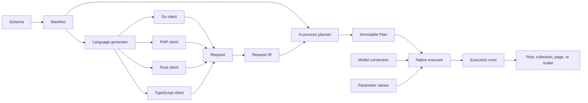
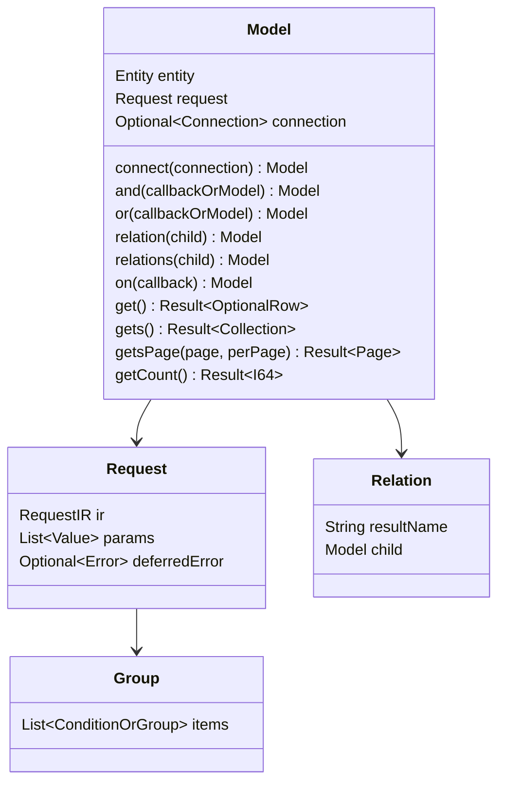
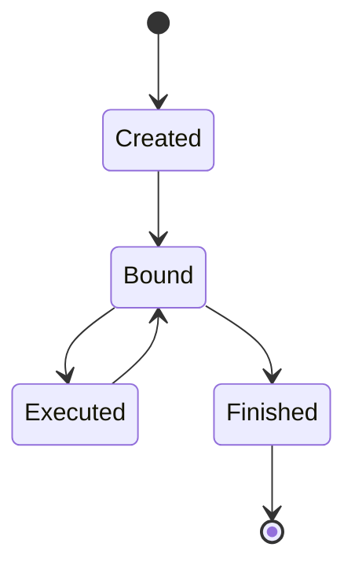
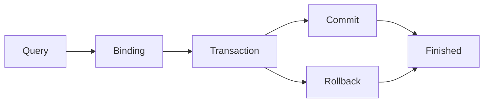
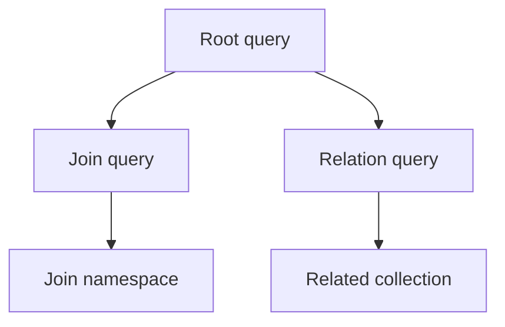
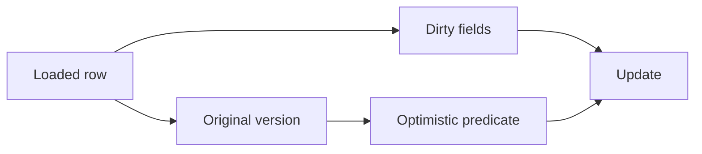
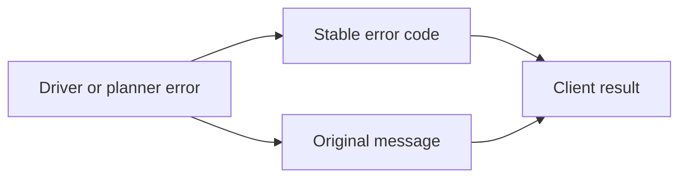
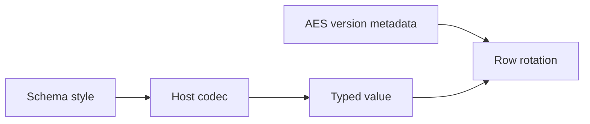

<!-- doc-id: interfaces -->
# Common interface v1

This page defines the shared public data structures, ownership rules, state transitions, and client call order for the syntax in the [DSL](dsl.md). Implementation status is recorded in [the implementation matrix](../operations/interface-implementation.md). A defined interface does not prove that every client implements it.

## 1. Call boundaries and change rules

The schema manifest defines entities, fields, operators, styles, and errors. Each language generates its models from the manifest with its own build tool. The client library validates a typed request shape and plans it in the calling process into an immutable plan. An executor receives the plan, parameter values, and the connection selected for the model.

The change order is: update the design plan and the DSL, update the manifest and generated artifacts, update all clients, run shared vectors, then update paired documentation. A client cannot add a private field or alternate call order to satisfy a shared interface.

## 2. Module call flow — IF-01

The planner does not receive database credentials or parameter values. The executor owns database access. A model receives its connection through `connect`; inside a transaction callback, a model without `connect` uses the active transaction of the current execution flow. A join or relation child without `connect` uses the parent connection.

## 3. Types and values — IF-02

- **INT-1** `I64` — Go: `int64`; PHP: `int`; Rust: `i64`; TypeScript: `number`; Python: `int`
- **INT-2** `F64` — Go: `float64`; PHP: `float`; Rust: `f64`; TypeScript: `number`; Python: `float`
- **INT-3** `Bool` — Go: `bool`; PHP: `bool`; Rust: `bool`; TypeScript: `boolean`; Python: `bool`
- **INT-4** `Text` — Go: `string`; PHP: `string`; Rust: `String`; TypeScript: `string`; Python: `str`
- **INT-5** `Bytes` — Go: `[]byte`; PHP: `string`; Rust: `Vec<u8>`; TypeScript: `Uint8Array`; Python: `bytes`
- **INT-6** `DateTime` — Go: `time.Time`; PHP: `DateTimeImmutable`; Rust: `NaiveDateTime`; TypeScript: `Date` for interface values (generated model getters use the canonical dbspec text `string`, and setters take text; see DBS-112 and DBS-121); Python: `str`
- **INT-7** `StyledValue`, the field of a column with a value codec, holding SQL NULL or the decoded value — Go: `orm.StyledValue`; PHP: `\Polyspec\Orm\StyledValue`; Rust: `polyspec_orm::StyledValue<T>`, `T` the decoded type of the codec; TypeScript: `StyledValue<T>`; Python: `StyledValue`
- **INT-8** `Optional<T>` — Go: `*T`; PHP: `?T`; Rust: `Option<T>`; TypeScript: `T | null`; Python: `T | None`
- **INT-9** `List<T>` — Go: slice; PHP: array; Rust: `Vec<T>`; TypeScript: `T[]`; Python: `list`
- **INT-10** `Result<T>` — Go: `(T, error)`; PHP: return or exception; Rust: `Result<T>`; TypeScript: `Promise<T>`; Python: return or exception
- **INT-11** `Key` — Go: `orm.Key`; PHP: `int|string|bool|Bytes|DateTimeInterface`; Rust: `polyspec_orm::Key`; TypeScript: `Key`; Python: `Key` (`int | str | bool | bytes | datetime.datetime`). Python `Collection.keys()` retains the type of each supported key and rejects values outside this key type. A key of a `datetime` column is a date and time of its instant in every implementation, never the text of the column, whether the key has one component or several. A TypeScript `Date` stops at the millisecond, so that key is a `Date` whose value is the instant cut to the millisecond and whose `toJSON()` returns the whole instant, UTC RFC 3339 with no trailing zero of its fraction; two microseconds of one millisecond are different keys, and such a key is found by the key that `keys()` returned. A `Date` that a caller builds is the key of its own millisecond.

Null, an empty list, a missing field, and a default value are different states. Serialization preserves the logical type and field order required by the codec specification.

## 4. Models and condition trees — IF-03 to IF-08

A model is both the query builder and the loaded row type. A group contains conditions or nested groups in order, and each item after the first carries an explicit `AND` or `OR` connector. `and(fn)` and `or(fn)` create nested groups whose callback receives an empty model of the same type, and `not(fn)`, `andNot(fn)` and `orNot(fn)` create negated ones (`NOT (…)`). `and(model)` and `or(model)` place the conditions of a joined child as a group. Join `ON` conditions are stored separately from `WHERE` conditions.

A terminal does not change the stored request, so repeated terminals produce the same statement.

- **INT-88** The query base of a generated model (Go `Core`, PHP `Model`, TypeScript `Core`, Python `Core`) keeps the first error that a builder call records for its request. The terminal returns that error before any statement is sent. The refusal of a condition value, such as an empty list (DSL-47), is such an error: the chain call records it and does not raise it.

## 5. Public API — IF-09 to IF-12

### 5.0 Connection input

Every public client accepts one DSN URI. `mysql://`, `postgres://`, and `sqlite://` select the database driver. Every connection reads and writes datetime values in UTC; the optional `timezone` parameter accepts only `UTC` or `+00:00`. The caller does not pass a second driver value.

- **INT-12** The `github.com/polyspec/orm/legacy/packages/go` Go module — Public connection call: `model.Connect(dsn, config)`; Result: `(*orm.DB, error)`
- **INT-13** The `polyspec/orm` PHP client — Public connection call: `\Polyspec\Orm\Tests\Model\connect(dsn, new Config(…))`; Result: `Db`
- **INT-14** The `polyspec-orm` Rust crate — Public connection call: `model::connect(dsn, pool_size, config).await?`; Result: `polyspec_orm::Db`
- **INT-15** The `@polyspec/orm` TypeScript package — Public connection call: `connect(dsn, options)` of the generated module; Result: `Promise<Db>`

### 5.1 Creation and language forms

- **INT-16** model creation — PHP: `new Product`; Go: `model.Product()`; Rust: `Product::new()`; TypeScript: `new Product()`; Python: `Product()`
- **INT-17** connection — PHP: `->connect($db)` or `($db)`; Go: `.Connect(db)`; Rust: `.connect(&db)`; TypeScript: `.connect(db)`; Python: `.connect(db)`
- **INT-18** collection terminal — PHP: `gets()`; Go: `Gets()`; Rust: `gets().await?`; TypeScript: `gets()`; Python: `gets()`
- **INT-19** count terminal — PHP: `getCount()`; Go: `GetCount()`; Rust: `get_count().await?`; TypeScript: `getCount()`; Python: `get_count()`

The creation spelling follows the host language. The method role, stored request, result type, error behavior, and call order remain the same.

### 5.2 Method groups

- **INT-20** conditions: Use column chains, operator prefixes, value shapes, and explicit connectors.
- **INT-21** groups: Preserve item order and nested group boundaries.
- **INT-22** relations: Use `match<L>With<R>` keys on the child and a separate statement per relation.
- **INT-23** joins: Keep `ON` and `WHERE` conditions separate and place child conditions where the child is passed to a group.
- **INT-24** projection: Preserve positional output mapping and reject duplicate row names.
- **INT-25** mutation: Record changed fields and original values.
- **INT-26** terminals: Receive chain values only and use the model connection.

#### Finder chains {#finder-chains}

`getBy<Chain>`, `getsBy<Chain>`, and `getCountBy<Chain>` apply a column chain as the condition and call the terminal. A chain is a combination of column keys, operators and connectors, so the set of chains has no bound, and no client lists them all. Each client reaches a chain in one of two ways, and the same chain gives the same rows in every client:

- **INT-27** Go static model types declare each chain found by scanning source calls; and Rust static model types do the same; and TypeScript static model types do the same. PHP and Python resolve names as the next item says. A chain no scanned call names has no method until code calls it and the models are generated again.
- **INT-28** The `polyspec/orm` PHP generator scan checks found names but declares no method; and PHP client `polyspec/orm` resolves call names dynamically through `__call`; and PHP-extension client `polyspec/orm-php-ext` does the same; and Python package `polyspec-orm` resolves call names at runtime through `__getattr`.

The case `terminal_by` of the recipe `conformance_verification` runs `getsBy<Chain>` on the non-unique columns `service_seq` and `is_close` in every runtime client, and the rows of each client must equal the recorded result.

### 5.3 Execution methods

- **INT-29** `get` — Result: one row; null when no row matches; Connection: model connection or active transaction
- **INT-30** `gets` — Result: collection; Connection: model connection or active transaction
- **INT-31** `getsCount` — Result: `GroupRows` with selected grouping values and checked row counts; Connection: model connection or active transaction
- **INT-32** `getsPage` — Result: page; Connection: model connection or active transaction
- **INT-33** `getCount` — Result: integer; Connection: model connection or active transaction
- **INT-34** `create` — Result: row with generated key; Connection: model connection or active transaction
- **INT-35** `creates(rows, batch)` — Result: inserted row count; `CONFIG` when `batch` is not a positive integer and `BATCH_TOO_LARGE` when a batch binds more than the dialect bind limit, both before any statement; Connection: model connection or active transaction
- **INT-36** `update` — Result: row; Connection: row connection or active transaction
- **INT-37** `delete` — Result: row or collection; Connection: row connection or active transaction
- **INT-38** `restore` — Result: the restored row; `NO_ROWS` when no row has the key; Connection: model connection or active transaction
- **INT-39** `restoreOrCreate` — Result: the restored or created row; `ROW_NOT_DELETED` when a row that is not deleted has the key; Connection: model connection or active transaction

A terminal without a connection outside a transaction returns `CONFIG`. A connection must carry the schema engine used by the generated request; otherwise the terminal returns `CONFIG`.

- **INT-68** `GroupRows` contains no partial models. Each row contains only selected grouping values and one nonnegative `row_count`. A missing, duplicate, malformed, or lossy count fails. Selected values retain their declared types, including boolean and SQL NULL; requesting an unselected value returns `COLUMN_UNSELECTED`.
- **INT-69** `GroupRow.toArray` (Go `GroupRow.ToArray`, PHP `GroupRow::toArray`, TypeScript `GroupRow#toArray`, Python `GroupRow.to_array`) returns one map of the selected values by name, with `row_count` as its checked integer count and SQL NULL as null.
- **INT-70** `GroupRows.length` (Go `Len`, PHP `count`, TypeScript `length`, Python `length`) returns the number of group rows; the rows are iterated in result order.
- **INT-71** `GroupRows.toArray` (Go `ToArray`, PHP `toArray`, TypeScript `toArray`, Python `to_array`) returns the `toArray` map of each group row, in result order.
- **INT-162** The JSON output of a group row (Go `json.Marshal`, Rust `GroupRow::to_json`, PHP and the PHP extension `json_encode`, TypeScript `JSON.stringify`, Python `GroupRow.to_json_text`) is one JSON object of its selected values in result order, and the JSON output of group rows (Go `json.Marshal`, Rust `GroupRows::to_json` and serde serialization, PHP and the PHP extension `json_encode`, TypeScript `JSON.stringify`, Python `GroupRows.to_json_text`) is the JSON array of those objects in result order. JSON has no bytes, so in every runtime, including the PHP extension, it refuses a bytes value, which is the value of a bytes column without a codec stage, with the same text: `CODEC_ENCODE: group column <name>: JSON output cannot write bytes`, such as `CODEC_ENCODE: group column body: JSON output cannot write bytes`; in Go `json.Marshal` returns it inside the `*json.MarshalerError` of `encoding/json`, whose `Unwrap` is that orm error. The array form of a group row holds the bytes (COD-27).
- **INT-90** A `GroupRow` whose `row_count` is negative fails with `CODEC_DECODE`, as does every `row_count` that is not an exact nonnegative integer (boolean, lossy, or beyond the safe integer range). A row with no `row_count` is `INTERNAL`. A row count is the database's `COUNT`, which is never negative, so a negative value is a received value that does not decode as a count, not a broken invariant of the library.

## 6. Connections, transactions, and utilities — IF-13 to IF-17

- **INT-72** `connection.transaction(fn, options)` runs the callback in one transaction. Begin, commit, rollback, and the executor are private. A callback error or exception rolls back the transaction; otherwise the transaction commits and the callback result is returned. A transaction whose start fails holds no connection afterwards: when a start step after BEGIN fails, the opened transaction is rolled back and its connection returns to the pool, and when BEGIN itself fails, the connection, whose session state is unknown, is closed rather than returned. Before the transaction ends, the client releases its MySQL `lock` locks, clears the MySQL values of `setLocal`, and restores the SQLite `query_only` and `read_uncommitted` modes, because named locks, user variables, and pragmas outlive `COMMIT` and `ROLLBACK` on a pooled connection. A connection returns to the pool only when every cleanup step and the `COMMIT` or `ROLLBACK` succeeded; after a failed step the state of its session is unknown, so the client closes the connection instead and the server ends its transaction, locks and values with the session. A pooled connection is therefore clean or discarded. The TypeScript SQLite driver holds its one connection, which it cannot close. Every cleanup step runs and every failed step is reported; a `RELEASE_LOCK` that does not return 1 is `CONFIG` `lock <key> was not held at transaction end`. When that cleanup fails at commit, the transaction rolls back and returns the cleanup error. When the callback, the begin, or the commit cleanup fails and the cleanup or the rollback fails too, the error is `ROLLBACK` `transaction failed (<cause>) and rollback failed (<transaction end error>)`; it keeps the cause and the transaction end error ([protocol](protocol.md)) and is not retried. A Go or Rust callback that panics, or a Go callback that leaves through `runtime.Goexit`, rolls the transaction back and the panic continues; when that rollback fails, the panic value is the `ROLLBACK` error of the same form. A rollback that fails because the server or the driver closed the connection, for example after a cancelled statement or a killed session, is a failed rollback too and is reported in that form, although the server ended the transaction with the session; a client that ends a failed transaction by closing its connection reports the cause alone. A Go transaction whose context is cancelled cannot run the cleanup statements, so it closes its connection instead of returning it to the pool and reports `CANCELED` alone; the server ends the transaction, its named locks, user variables and SQLite modes with the session. A Rust transaction future dropped before its transaction ends closes the connection at once, over TLS too, so the server ends the transaction and its locks with the session. A failed `COMMIT` is reported with its own code; a transaction that it left open is rolled back and that rollback reports nothing unless it fails. The rollback fault of [protocol 3.1](protocol.md#_3-1-test-faults) belongs to the rollback after a failed callback: a failed `BEGIN` or `COMMIT` leaves it armed.
- **INT-72a** Retired: the statement of the transaction forms that the `polyspec-orm` crate had; INT-190 states the rollback fault of its one transaction form.
- **INT-190** The `polyspec-orm` crate's `Db::transaction` reports a rollback fault as the kind `rollback_failed` of CORE-25, which holds the failure of the callback, and consumes it.

- **INT-40** `isolation`: `default`, `read_uncommitted`, `read_committed`, `repeatable_read`, `serializable`
- **INT-41** `readOnly`: boolean
- **INT-42** `timeoutMs`: positive integer, and `0` is the same as omitting it; PostgreSQL applies `statement_timeout`, MySQL and SQLite return `CAPABILITY_UNSUPPORTED`
- **INT-43** `retry`: deadlock retry count, default `3`; each retry runs the complete callback again, and `0` disables retry
- **INT-44** `audit`: column name to value of the unit of work's audit record; the transaction inserts the values of the connection's audit source with these values (a value wins) into the audit record table right before its first write of an audited table, in every attempt, so a transaction that writes no audited row inserts none, and every audited write in the transaction writes the record's key ([usage](../operations/usage.md#audited-writes))
- **INT-44a** Retired: the statement of the audit of the transaction forms that the `polyspec-orm` crate had; INT-188 states the audit of its one transaction form.
- **INT-188** The `polyspec-orm` crate takes `audit` in the `TransactionOptions` of `Db::transaction`, its one transaction form (CORE-20); `Tx::savepoint` takes no options, so a savepoint keeps the audit of its transaction (CORE-21).
- **INT-44b** The `polyspec/orm-php-ext` package's PHP extension runs the audit calls `transaction`, `get`, `update`, `delete` and `restore` as internal methods of its native classes.

The connection configuration takes `auditSource`, a function that returns the audit values of the current request ([configuration](config.md)). A transaction with `audit` on a connection without a source, a value that is not a column of the audit record table, and an audited write without `audit` fail with `CONFIG`; an error of the source fails the transaction; a nested transaction keeps the outer audit and does not take `audit`.

- **INT-45** Each execution flow keeps a stack of active transactions: the goroutine in Go, the request in PHP, the async context in TypeScript, and the task in Rust. A model without `connect` uses the innermost transaction.
- **INT-46** A transaction on the same connection inside an active transaction creates a savepoint. An inner failure rolls back only the inner work unless the outer callback returns it. After a callback error, a panic or a Go `runtime.Goexit`, the client runs both `ROLLBACK TO SAVEPOINT` and `RELEASE SAVEPOINT`; when either fails, the error or the panic value is `ROLLBACK` `transaction failed (<cause>) and rollback failed (<savepoint end error>)`, and a failed `RELEASE SAVEPOINT` after a successful callback is returned. A savepoint of a transaction that a cancelled transaction context has already ended ended with it.
- **INT-46a** Retired: the statement of the nested `transaction_send` that the `polyspec-orm` crate had; INT-189 states its savepoint.
- **INT-189** The `polyspec-orm` crate has no nested transaction: `Tx::savepoint` creates the savepoint of INT-46 in the transaction of its handle (CORE-21).
- **INT-47** Concurrent use of one transaction connection returns an error. A task or goroutine started inside the callback has no active transaction.
- **INT-48** `transactionConflict(message)` (Go: `orm.TransactionConflict`; Python and Rust: `transaction_conflict`) creates the retryable `DEADLOCK` error.
- **INT-49** Row locks `forUpdate()`, `forShare()`, `forUpdateNoWait()`, and `forShareNoWait()` are allowed only inside a transaction. MySQL and PostgreSQL append the lock clause; SQLite uses an ORM transaction-scoped lock row. A `*_nowait` request that cannot acquire the lock returns `LOCK_NOT_AVAILABLE` on every adapter.

- **INT-73** `connection.utils()` provides operations outside the query syntax.

- **INT-50** `lock(key)`: transaction-scoped named lock: MySQL `GET_LOCK`, PostgreSQL advisory lock, SQLite ORM lock row; requires an active transaction
- **INT-51** `setLocal(key, value)`, `local(key)`: transaction-local values; requires an active transaction; `local` returns `NO_ROWS` for a missing key
- **INT-52** `wasInserted(entity, sequence)`: reports whether a generated ORM insert for the sequence succeeded in the active transaction; the fact is adapter-neutral and restored across savepoint rollback
- **INT-53** `backendWaitingForLock(ctx)`: reports PostgreSQL pool backends waiting for a lock; MySQL and SQLite return `false` without exposing a driver-specific caller API
- **INT-54** `schema().register(schema)`: takes the generated schema value and registers its set on the connection without reading or writing the database; fails with `CONFIG` when its manifest text does not hash to its `manifestHash`
- **INT-55** `schema().install(schema)`: takes the generated schema value, fails with `CONFIG` before any statement when its manifest text does not hash to its `manifestHash`, renders the dbspec document set for the dialect of the connection and creates every table when none exists, and registers the set on the connection; changes nothing when every table exists and returns `CONFIG` when only some exist; then returns `CONFIG` naming each difference when the tables of the set in the database differ from the set; on MySQL a call inside a transaction returns `CONFIG`
- **INT-56** `schema().addTablesAndColumns(schema)`: takes the generated schema value and upgrades its installed document set by the tables the database lacks, the missing columns of the existing tables that are null or have a default and the missing indexes of the existing tables, with the plan steps of the dialect, which create each table with its indexes, foreign keys, checks and triggers and replace the audit triggers of each changed table; returns the created tables as `table`, the added columns as `table.column` and the created indexes as `table.index`, leaves the tables of other sets unchanged and registers nothing; any other difference returns `SCHEMA_DIFFERS` before any change, and a missing unique key returns it with the reason that it can fail on the existing rows and belongs to a plan; on MySQL and SQLite a call inside a transaction returns `CONFIG`
- **INT-57** `schema().exists(schema)`, `schema().installed(schema, table)`: schema inspection
- **INT-58** `schema().empty()`: reports whether the database holds no user content. On PostgreSQL a schema other than `public`, `information_schema` and the `pg_` schemas is content even without objects, and so is a table, partitioned table, view, materialized view, or foreign table in `public`; functions, types, and sequences in `public` are not content. On MySQL a table or view of the connected database is content; on SQLite a table or view other than the `sqlite_` tables and the ORM's `orm__` tables is content
- **INT-59** `privileges().grantTable(table, role)`, `revokeTable(table, privilege, role)`, `inspectTable(table)`: table privileges; non-PostgreSQL dialects return `CAPABILITY_UNSUPPORTED` once the arguments are checked, so an invalid argument is `CONFIG` on every database (DIA-225). The privilege of `revokeTable` is one of `SELECT`, `INSERT`, `UPDATE`, `DELETE` and `TRUNCATE` written in ASCII letters of either case, as an SQL keyword is; any other text, one with white space around it or with a letter outside ASCII among them, is `CONFIG: unsupported table privilege "<privilege>"` with the privilege as it was given, quoted as INT-187 states
- **INT-59a** PHP-extension package `polyspec/orm-php-ext` implements `PrivilegeUtils` and its three table privilege methods natively.
- **INT-60** `aes().status(model, keyring)`, `aes().rotate(model, keyring)`: AES key version status and rotation of every AES column and the version in one transaction
- **INT-61** `stats()`: connection pool statistics
- **INT-74** `AESKeyring.versions()` (Go `AESVersions`, PHP `versions`, TypeScript `versions`, Python `versions`) returns the declared key versions in ascending numeric order.
- **INT-75** `AESRotationStatus` has the fields `current` (the keyring's current version), `total` (the rows of the model table), `pending` (the rows whose stored version is not `current`) and `versions` (the row count of each stored version); `aes().status(model, keyring)` builds it.
- **INT-76** `execute(step, params)` runs one compiled statement step with the request parameters on the connection or its active transaction, as [execute a compiled statement](../operations/usage.md#execute-a-compiled-statement) states. A step that reads rows, or a `param` bind slot past the parameters, fails with `IR_INVALID` before any statement runs; `execute` returns nothing.
- **INT-77** `subscribe(subscriber)` registers a subscriber that receives the event of every statement of the connection and its handles after the statement ends, in registration order, and returns a function that removes it; a markdown connection returns `CAPABILITY_UNSUPPORTED`.
- **INT-77a** The `polyspec/orm-php-ext` package's PHP extension runs the statement event entry points `publish`, `observed`, `run` and `fetch` as internal methods of `Db`, and the function that `subscribe` returns frees the subscriber, so a process that subscribes and unsubscribes over and over keeps its resident set flat.
- **INT-78** `withRequestHook(hook)` returns a handle of the same connection whose hook receives each request and its bound parameter values right before it is planned. Bound parameter values are read-only; the hook may append parameters only through the supplied parameter-add operation. The handle shares the connection, the plan and statement caches, the statement event subscribers and the active transactions; calling `withRequestHook` on a hooked handle replaces its hook. The client plans the request only after the hook has returned: in a client whose calls return a promise or a future, the hook may return one too, and the client awaits it, so that a hook of every client can run a statement on another connection between the end of one request and the planning of the next, inside a transaction.
- **INT-78a** Go returns the connection from the `Root` of a handle that `WithRequestHook` returned, and TypeScript and Python do the same from `root()`. PHP, the PHP extension and Rust have no public root, so this case is native under FCV-2.
- **INT-79** `stats()` returns the pool counts of the connection: the maximum of open connections, the open connections, the connections in use, and the idle connections (Go `DBStats`, PHP `Stats`, TypeScript `PoolStats`, Python `DbStats`).
- **INT-150** The statement runner is public API with one shape in every runtime: `utils().run(fn)` is the one public statement runner. It calls `fn` with a transaction frame of the connection: it opens a transaction when none is active, and joins the active transaction otherwise, ending a transaction it opened as `transaction` does and without retry. The frame's `run(kind, tables, sql, params)` (the TypeScript `TxFrame.run` order and meaning, the same in every runtime, with `params` optional) runs one statement of kind `kind`, touching the `tables` list (empty when none), records one statement event (INT-77) and returns the statement result with its rows. The frame passes the active transaction and never opens one. A statement that is not text fails with `CONFIG`; every other error is the database error code of the statement. Python takes the same frame in `utils().run(fn)`, and `active_frame()` keeps returning the open transaction frame or none. Ruling (T345): the meaning and the argument names of the frame call are shared by every runtime. A runtime that has no public frame call yet takes TypeScript's positional order `(kind, tables, sql, params)`. Python's public `TxFrame.run` keeps its signature; its parameter `values` is a recorded difference from `params` and is not renamed. A runtime may leave the runner out only by a declared exception listed in this rule with its reason; none is declared, so every runtime implements it.
- **INT-161** Python: `Db.active_frame()` is public and returns the transaction frame open on the connection, or `None` when none is open. Inside the callback of `utils().run(fn)` it is the frame that `fn` receives, inside `transaction` the frame that a joined `utils().run(fn)` receives, and after the transaction ends it is `None` again.
- **INT-150a** Go fails with `CONFIG` on a frame used after its transaction ended and sends no statement, and PHP and the PHP extension and TypeScript and Python do the same. A Rust frame cannot outlive the callback that borrows it, so its compiler refuses that use.
- **INT-150b** PHP fails with `CONFIG` on a statement that is not text and sends no statement, and the PHP extension and TypeScript and Python do the same. The Go and Rust `run` take the statement as a text, so their compilers refuse that use.
- **INT-67** Abandoning a handle releases what it holds: an abandoned query handle cancels its statement if it has not finished, and an abandoned transaction or connection handle rolls back its open transaction and returns its connection to the pool. Each language abandons by its own disposal form: Rust drops the value, Go cancels the context or calls `Close`, Python leaves the context manager or calls `close()`, TypeScript aborts the `AbortSignal` or calls `close()`, and PHP destroys the object or calls `close()`.

Utilities that change data open a transaction when none is active and join the active transaction of the same connection otherwise.

## 7. Planning and assembly — IF-18 to IF-20

`Request` contains the schema hash, IR version, entity, predicate tree, relation requests, projection, and parameter count. Parameter values are stored separately from the request shape. The client planner produces an immutable plan with dialect-specific SQL and positional assembly metadata. The shared interface requires all six configured implementations (Go, PHP, PHP extension, TypeScript, Python and Rust) to produce the same SQL for the same request; conformance vectors check executable behavior separately.

Assembly uses `{alias, column, output_name, index}`. Join aliases remain separate from the root namespace. Duplicate output names return `COLUMN_ALIAS_CONFLICT`. A schema hash mismatch returns `SCHEMA_HASH_MISMATCH` before execution.

## 8. Row values, dirty state, and relations — IF-21 to IF-24

A model row stores declared fields, added columns, relation results, and values attached with `new<Name>` in one name space; duplicate names are rejected. Getters return the declared type. Setters update the field and mark it dirty. Update operations send dirty fields only, except fields required by optimistic locking. The original version is read before mutation and is used in the update predicate.

- **INT-160** An added column whose plan column states a type returns that type in every runtime: `i16`, `i32`, `i64`, `f64`, `bool`, `date` and `datetime` are decoded as a declared column of the type is. A text is an integer of the type only when it is exactly the digits of an integer in its range, so a DECIMAL above the range, or with a fraction, fails with `CODEC_DECODE`; TypeScript holds the range of COD-45. A scalar subquery that sums an `i16` or `i32` column has the plan type `i64`, since a sum leaves the range of its column. A scalar subquery of a `decimal(p,s)` column, its value or its sum, is its exact decimal text of `s` fraction digits on every database: SQLite and markdown store the integer times 10^s of DIA-25 and MySQL and PostgreSQL send a text, padded to `s` digits; a value is refused as a cell of the column, past `p` digits included, a sum has any number of digits, and the sum of a column that holds a value of more than `s` fraction digits fails with `CODEC_DECODE: column <column> holds a value that is not a decimal of scale <s>`. A plan column of any other type, or with no type, returns the driver value. A subquery sum above the i64 range fails with that `CODEC_DECODE` on every database, SQLite and markdown included, whose executor combines the sums of the parts of PRT-84.

A relation result is either one row or a collection according to the schema. The Go and Rust relation getters also return an error: a row without a related row reads as no result, and a stored relation value of another type than the getter's result is `INTERNAL`. Collection keying is deterministic. A duplicate key follows the declared key policy; an undeclared key function is invalid.

- **INT-87** `relation(child)` and `relations(child)` add the child as a relation whose result is one row or a collection, respectively. The child needs `match<L>With<R>()` keys, and a relation added inside a group callback is refused; each refusal records a `CONFIG` error that the terminal returns.

## 9. Collection, key, and page — IF-25 to IF-27

- **INT-62** `Collection<T>`: ordered rows, length, first, key lookup
- **INT-62a** PHP-extension package `polyspec/orm-php-ext` native collection guarantees what its tests assert: `put` of a key already present replaces the model in its place, `toJson` and `jsonSerialize` give the models in collection order, and the collection called with a connection connects every model and returns the collection as `connect` does.
- **INT-63** `Key`: logical type tag and value
- **INT-64** `Page<T>`: `items`, `totalCount`, `totalPages`, `page`, `perPage`
- **INT-164** Lookahead pages: a page that reads one row past its end to learn whether a next page exists, and counts nothing. `getsLookaheadPage(page, perPage)` (Go `GetsLookaheadPage`, Rust and Python `gets_lookahead_page`) returns a `LookaheadPage<T>` whose `items` are the models of the page (a `Collection<T>`, INT-62), and `getsCountLookaheadPage(page, perPage)` on a `groupBy` chain (Go `GetsCountLookaheadPage`, Rust and Python `gets_count_lookahead_page`) returns a `GroupLookaheadPage` whose `items` are the `GroupRows` of `group_count` (INT-68) of the page. Each type has exactly the fields `items`, `page`, `perPage` and `hasNext` (Go `Items`, `Page`, `PerPage`, `HasNext`; Rust `items`, `page`, `per_page`, `has_next`; Python the keys `items`, `page`, `perPage` and `hasNext` of a dict, as the `Page` of INT-64), and no total, in all six runtimes. Each runs the request kind `lookahead_paginate` or `group_lookahead_paginate` (PRT-2), whose root is one statement with `LIMIT perPage + 1 OFFSET (page - 1) * perPage` and no count statement (PRT-38): `hasNext` is true when that statement returns more than `perPage` rows, and the extra row only sets it and is never returned. A page past the end has no items and `hasNext` false, with no error; whether that is not found is the application's decision. When the chain declares no order, the model page orders by its primary key ascending, in key column order, and the grouped page by its `group_by` columns ascending, in declaration order, so that consecutive pages neither repeat nor skip a row. `page` and `perPage` must be positive and a chain with `limit` is refused, both with `CONFIG` before any statement, as for `getsPage` (DSL-67); `getsCountLookaheadPage` on a chain without `groupBy` fails with `IR_INVALID` "group_lookahead_paginate needs group_by", as `getsCount` fails with "group_count needs group_by". `getsPage` (INT-64) orders a chain without an order by its primary key in the same way (DSL-67), and a grouped `getsPage` keeps its refusal (DSL-99).
- **INT-80** `Collection.get(key)` returns the model whose key has the same type and value as `key`. When no model has the key, the result is none: the zero value with no error in Go, `null` in PHP, `undefined` in TypeScript and `None` in Python. A SQL NULL key fails with `CODEC_DECODE`; Go returns the conversion error of `KeyOf` for a key it cannot convert.
- **INT-81** `Collection.keys()` returns the key of each model in collection order.
- **INT-82** `Collection.values()` (Go `Slice`, PHP `all`) returns the models in collection order.
- **INT-83** `Collection.entries()` (Go `All`, which yields key and model pairs) returns each key with its model in collection order.
- **INT-84** `Collection.toArray()` returns the `toArray` map of each model, in collection order.
- **INT-85** `Collection.connect(db)` sets the connection of every model of the collection to `db` and returns the collection.
- **INT-86** `Collection.fetchedValue(key)` returns the value fetched with the model of `key`. When no model has the key, the result is none: Go `nil` with no error, PHP `null`, TypeScript `undefined`, Python `None`.

The integer key `7` and text key `"7"` are different keys. A boolean `true` and the integer `1`, bytes and text with the same characters, and a date and time and the text of its form are different keys; a date and time in another zone is the key of its UTC instant. A NULL key component is `CODEC_DECODE`. Composite keys encode each typed component with its length, so `("1", "23")` and `("12", "3")` cannot collide. The plan records the ordered collection identity in `Assemble.key`. Regular rows use every primary-key component; grouped count rows use their group columns and expression aliases. A collection preserves database order unless an explicit order or key policy changes it. A page preserves the root result order and relation attachment order.

Go key conversion preserves the logical types of signed integers, booleans, text, bytes, finite floating-point values, and times. An unstyled byte column remains bytes after database scanning, including a joined column. Unsigned integers must fit a signed 64-bit value. A null or unsupported value returns an error; a null database identity component is absent. Composite keys retain component type, order, and length. `KeyOf`, `Key.Value`, and collection `Get`, `Has`, and `FetchedValue` report invalid keys with an error. Collection lookups, relation matching, and split-query deduplication propagate conversion errors instead of converting values to text.

## 10. Configuration, errors, codecs, and events — IF-28 to IF-31

Configuration selects the dialect, DSN, schema file, executor, AES key version map, and query event hook. It does not select another database or silently change the request path.

Errors use the codes in [errors.yaml](errors.yaml). Go callers use `orm.ErrorCode`, `orm.IsDeadlock`, `orm.IsLockNotAvailable`, `orm.IsDuplicateKey`, `orm.IsForeignKey` and `orm.IsConstraint` for adapter-neutral classification; they do not inspect driver error types. Codec styles are schema declarations. The AES version column is non-null integer plaintext metadata with no encoding style and is excluded from the default projection. AES rotation updates all AES payload columns and the version in one transaction.

- **INT-65** Every implementation (Go, PHP, the PHP extension, TypeScript, Python and Rust) exposes every code of [errors.yaml](errors.yaml) as a native constant of its error-code catalog whose value is the code, and the catalog equals errors.yaml: it lacks no code and adds none.
- **INT-154** The message of a SQLite driver error ends with the name of its extended result code in parentheses, after the driver text, in every implementation: `no such collation sequence: nosuch (SQLITE_ERROR_MISSING_COLLSEQ)`. A SQLite error message states only the primary meaning, so an extended code such as `SQLITE_IOERR_SHMLOCK`, `SQLITE_IOERR_FSYNC` or `SQLITE_IOERR_SHORT_READ` is known only from this name. SQLite has no API that names a code, so the names are the table of [sqlite-result-codes.yaml](sqlite-result-codes.yaml), which `orm-gen sqlite-codes` writes into each implementation; a code the table does not list is written as `(SQLite result code <n>)`. The PHP client and the PHP extension turn on the extended result codes of pdo_sqlite (`Pdo\Sqlite::ATTR_EXTENDED_RESULT_CODES`), since pdo_sqlite reports only the primary code otherwise. The recipe case `sqlite_extended_code_names` of `contracts/fixtures/catalog_connection/catalog_connection.json` checks it.
- **INT-155** A transaction or savepoint that SQLite rolled back by itself, as it does after `RAISE(ROLLBACK)`, an I/O error or a full disk, reports the error that ended it, in every implementation and in the catalog connection. Before each ROLLBACK, ROLLBACK TO SAVEPOINT and RELEASE SAVEPOINT on SQLite, the implementation asks the connection whether its transaction is still open, and sends no such statement when it is not: that statement would fail with `cannot rollback - no transaction is active` and stack a rollback failure on the error. The open state comes from SQLite itself: `sqlite3_get_autocommit` (Rust), the SQLite rollback hook (Go, whose driver exposes no autocommit state), `isTransaction` of node:sqlite (TypeScript), `Connection.in_transaction` (Python), and `PDO::inTransaction` (PHP and the extension). MySQL and PostgreSQL keep their rollback as before.
- **INT-89** An error of every client is a library error that carries one stable code of [errors.yaml](errors.yaml) and is classified by that code: Go `ir.Error` (`orm.Error`) with `Code`, PHP `OrmException` with `code_`, TypeScript `OrmError` with `code`, and Python `OrmError` with `code`.
- **INT-163** The message of an error that a client writes names no value that a caller or a database supplied, in every client: no parameter value, column value, stored cell, key version or document text, and no host type of one. It names the code, the entity and the column or the parameter index, and the rule that the value breaks, as one text in every client (COD-1, COD-41, COD-44), so an error carries no data to a log and reads the same in every runtime. The text of a driver error is the driver's, kept as errors.yaml states.
- **INT-187** The message of an error that a client writes is one text in every client, and a text that it quotes — a name, a key, a refused input or a text of the database, such as a flowmark answer that is no JSON object — is quoted in double quotes, `"<text>"`, with the quoting of DBS-144: the quote character and `\` take a backslash before them, BEL, BS, FF, LF, CR, TAB and VT are written `\a`, `\b`, `\f`, `\n`, `\r`, `\t` and `\v`, any other code point below U+0020 and U+007F is `\x` and two lower-case hex digits, a byte that is not part of UTF-8 (Go, PHP and the PHP extension hold one) is `\x` and its two lower-case hex digits, a lone surrogate (TypeScript and Python hold one) is `\u` and its four lower-case hex digits, and every other code point is written as it is, with no Unicode table. Which texts a message quotes is part of its one text: an identifier that the client has checked against its grammar may stand bare, as `ENTITY_UNKNOWN: <name>` does. No message quotes a name or a text with the quoting of a host language: Go `%q`, Rust `{:?}`, Python `repr`, TypeScript `JSON.stringify` or PHP `json_encode` and `var_export`. An error that a layer below the client gave, an operating system, a driver, a database server or a JSON parser, is written as the text of the client, a colon and a space, then the text of that error as it gave it, unchanged, and that error is also the cause of the error of the client; the text of the client is the same on every runtime, the text of the error below is the one that the runtime received, and no client leaves it out or replaces it. Each runtime writes the quoting with one function, which its dbspec diagnostics use too, and the recipes that state a message hold the same text on every runtime, or, for an error from below, the same text of the client before it (T430).

- **INT-91** A statement event of every client records one statement that the connection sent, with exactly these seven fields: `sql` is the statement as sent; `binds` is the bound values in order, where an executor clock value is `$NOW`; `kind` is the statement kind, one of `select`, `insert`, `update`, `delete`, `begin`, `commit`, `rollback`, `savepoint`, `release`, `rollback_to`, `schema` and `utility`; `tables` is the tables the statement names, sorted; `elapsed` is the time from sending the statement until the client read its result; `transaction` is the number of the connection's transaction the statement ran in, counted from 1 by every outermost begin, and none outside a transaction; `error` is the error the statement ended with, or none. Each client names the fields in its own spelling and expresses "none" in its native form: Go `SQL`, `Binds`, `Kind`, `Tables`, `Elapsed`, `Transaction` (zero outside a transaction) and `Err` (nil), with `Elapsed` a `time.Duration`; PHP `Polyspec\Orm\StatementEvent` with the properties `sql`, `binds`, `kind`, `tables`, `elapsed` (seconds), `transaction` (null) and `error` (null); TypeScript `StatementEvent` with the same names, `elapsed` in seconds, and `transaction` and `error` `null`; Python `StatementEvent` with the same names, `elapsed` in seconds, and `transaction` and `error` `None`, where `error` is the exception the statement raised, of whatever type it is; Rust `StatementEvent` with the same names, `elapsed` a `Duration`, and `transaction` and `error` `None`.
- **INT-92** A connection that the server ends while the pool holds it idle is discarded by the pool: the process keeps running, the error of that connection is handled by the pool, and the next statement runs on a new connection.
- **INT-93** The `@polyspec/orm` package's published TypeScript declarations type-check in a project that has none of the driver types (`pg`, `@types/pg`, `mysql2`) installed; they import none of the driver modules, so an application needs only the types of the driver it uses.
- **INT-94** The `polyspec/orm-php-ext` package's PHP extension `polyspec_orm` declares the `pdo` module as a required module, so PHP loads the extension only when pdo is present.
- **INT-95** The `polyspec/orm-php-ext` package's `legacy/packages/php-ext/composer.json` is of type `php-ext` and names the extension `polyspec_orm`, and its build-path holds the `config.m4` that builds that extension.
- **INT-156** `legacy/packages/php/composer.json` declares every PHP extension whose class or function `legacy/packages/php/src` names, except the extensions that every PHP build holds (Core, standard, date, pcre, Reflection, SPL, random, hash): in `require` when the client cannot run without it, and in `suggest`, with the feature it serves, when only one database or feature uses it.
- **INT-156a** The `polyspec/orm-php-ext` package's PHP extension implements `SchemaUtils` natively: the class and its methods `register`, `install`, `addTablesAndColumns`, `exists`, `installed` and `empty` are internal, a subscriber failure stops an installation with `SUBSCRIBER` and leaves no table, and an object that is not a `Schema` or an invalid identifier is refused before any statement.
- **INT-156b** The `polyspec/orm-php-ext` package's PHP extension implements `AesUtils` natively: the class is internal, and `status` and `rotate` check their keyring before the metadata of the model, so an object that is not an `AesKeyring` is a `TypeError` that names the method and sends no statement.
- **INT-96** A statement event subscriber that raises an error fails its statement with `SUBSCRIBER`. The message of that failure is `SUBSCRIBER: statement event subscriber failed: ` followed by the text of the subscriber's error (for an ORM error, its code, a colon and its message), and the subscriber's error is the cause of the failure.
- **INT-130** `AESKeyring` (Go `AESKeyring`, PHP `AesKeyring`, TypeScript `AESKeyring`, Python `AesKeyring`, Rust `AesKeyring`) holds the declared AES key versions and the current version (Go `CurrentAESVersion`); it is the keyring argument of INT-60.
- **INT-131** `AESUtils` (Go `AESUtils`, PHP `AesUtils`, TypeScript `AESUtils`, Python `AesUtils`, Rust `AesUtils`) is the value of `aes()` (INT-60) and exposes `status(model, keyring)` and `rotate(model, keyring)` as the operations of INT-60.
- **INT-132** `Db.connectSchema(dsn, schema)` (Go `ConnectSchema`, PHP `Orm::connectSchema`, TypeScript `Db.connectSchema`, Python `Db.connect_schema`, Rust `Db::connect_schema`) connects to the DSN and registers the schema value as INT-54 does; it fails with `CONFIG` when the manifest text does not hash to its `manifestHash`. The TypeScript generated module's public `connect(dsn, options)` helper calls `Db.connectSchema(dsn, SCHEMA, options)`.
- **INT-133** `Schema` (Go `Schema`, PHP `Schema`, TypeScript `Schema`, Python `Schema`, Rust `Schema`) is the generated schema value: the manifest text, its `manifestHash`, and the external document text of the set when it uses external documents. It is the argument of INT-54 through INT-58 and of INT-132.
- **INT-134** `Utils` (Go `Utils`, PHP `Utils`, TypeScript `Utils`, Python `Utils`, Rust `Utils`) is the value of `connection.utils()` (INT-73) and holds the utility groups of INT-50 through INT-61, among them `schema()`, `privileges()`, `aes()` (INT-131) and `stats()`.

Secrets and parameter values are excluded from logs.

## 11. Generator, schema, and extension boundaries — IF-32 to IF-34

The generator reads the schema manifest and emits models, fields, column methods, and error types. Go and Rust generation also reads the scanned source and emits the chain, relation key, join, and `new<Name>` methods that the source calls. It must not emit a method for an undeclared column or operator. Generated code is checked against the manifest and the interface symbol list.

- **INT-66** The code that the generator emits passes the standard compiler of its language and the formatter and linter that the lint checks of this repository run for that language, and the generated text suppresses no finding: it carries no Rust `allow` attribute, Go `//nolint`, Python `# noqa`, PHP `@phpstan-ignore` or `phpcs:ignore`, or TypeScript `eslint-disable` or `@ts-ignore`.

Relations use `relation(child)` and `relations(child)` with `match<L>With<R>()` on the child. Joins use `join<L>With<R>(child)` and `leftJoin<L>With<R>(child)`. Unknown names fail during PHP and TypeScript call resolution and during Go and Rust generation.

## 12. Verification

The verification suite checks the manifest, generated symbols, stored fields, request shape, state transitions, error codes, codec vectors, relation results, and database results. It also checks document pairs, static Pages output with its Mermaid sources, and repeated-build bytes.

The interface check rejects a declared or called `multi_statement` method in Go, PHP, Rust, TypeScript, and Python source. Its source mutation cases verify both failures. The CI workflow runs the generated Go model, interface, and schema checks; a test fails if any command is removed.

A passing symbol check proves the declared surface only. A passing conformance vector proves the tested input and result. A feature is complete only when all supported clients, required databases, tests, documents, and Pages checks pass.

### Catalog grid query cells

Every client's `read_only_grid_query(sql, params, limits)` returns ordered
column metadata and typed grid cells. Binary cells preserve bytes and remain
distinct from text, including empty binary and valid UTF-8 binary. SQL NULL
is a separate cell. Grid decoding does not modify catalog/schema coercion
rules or add a compatibility fallback. It uses the same database-enforced
read-only scope, connection disposal and explicit query budgets. Unsupported
types fail explicitly with `CATALOG_VALUE`.

Floating-point cells preserve the exact IEEE-754 bits, including signed zero
and nonfinite values, without JSON number coercion. Implementations may use
their native typed representation at their public API. The MySQL unsigned
integer cell preserves the full unsigned 64-bit range. These grid values do not
change schema/catalog scalar conversion rules.

Finite grid decimal cells use exact plain decimal strings, preserving the
database's declared result scale, including trailing zeros. Do not pass through
binary floats or fixed-precision model codecs. SQLite has no native decimal
storage class: its actual text/integer/real values keep their existing tags.
Nonfinite PostgreSQL numeric values fail explicitly with `CATALOG_VALUE`.

Temporal grid cells hold the dbspec text forms: `Date` is `YYYY-MM-DD`, `Time`
is `HH:MM:SS` and `DateTime` is `YYYY-MM-DD HH:MM:SS` in UTC, the latter two with
fraction digits. MySQL `DATE`, `TIME` and `DATETIME` and PostgreSQL `date`,
`time` and `timestamp` without time zone decode into them; MySQL `TIMESTAMP` and
PostgreSQL `timestamptz` and `timetz` remain unsupported. A read of a described
table (table page, row lookup, insert reads) writes exactly the declared
precision p of the column, where MySQL `time` and `datetime` without p have 0 and
PostgreSQL `time` and `timestamp` without p have 6; a read-only grid query has
no column declaration and writes six digits. A time outside 00:00:00 to
23:59:59.999999, a date outside 0001-01-01 to 9999-12-31 and a PostgreSQL
infinity fail. SQLite has no temporal storage class: a read of
a described table turns the stored text of a `DATE`, `TIME` or `DATETIME`
column into the same temporal cell as MySQL and PostgreSQL, whose fraction
digits the dbspec CHECK fixes at p, and a value that is not in the dbspec form
fails with `GRID_TEMPORAL_VALUE`; a read-only grid query has no declaration and
keeps the stored text.

### Qualified catalog table metadata

`current_namespace()` reports the selected namespace. `describe_table` resolves
an explicitly qualified table through bound catalog names, preserving native
column types, declared primary-key order, actual nullability and generated-column
flags. Do not derive identity from logical schema column order or arbitrary query
results. SQLite supports its connected `main` namespace; nullable legacy primary
keys are not reliable identity, while a genuine INTEGER rowid alias is non-null.
A descriptor is not edit authorization: table mutation requires explicit
commands, validated schema/row revisions, typed binds and optimistic conflict
checks.

`TableMetadata` contains the qualified `table`, native relation `kind`, ordered
`columns` (`name`, `native_type`, `nullable`, `generated`), constraint-ordered
`primary_key` and `reliable_row_identity`. Identity requires an ordinary or
partitioned table with a nonempty, entirely non-null primary key. Generated
flags also cover PostgreSQL always-generated identity and SQLite hidden columns;
they are not a complete writable-column permission model. Preserve an empty
SQLite native type for an untyped column rather than inventing a type.

Names require 1..1024 UTF-8 bytes and no NUL. Each catalog result is bounded to
2048 rows and 4 MiB. Unsupported relation kinds and SQLite namespaces fail
explicitly. A DSN that names no supported dialect fails with `CONFIG` and creates no file. This descriptor is not a complete physical schema import or an
atomic schema revision; mutation must revalidate metadata in its owning scope.

MySQL `SYSTEM VIEW` catalog relations are classified as views, never as tables
or writable row identity. Unknown native relation kinds still fail explicitly.

### Catalog typed bind values

Catalog parameters preserve their declared logical type and are bound through
the selected driver's typed parameter API, never formatted into SQL text.
Unsigned integers are MySQL-only. SQLite rejects Decimal and Float32, and
preserves its native integer/float64/text/blob storage classes without implicit
widening or numeric-affinity coercion. PostgreSQL supports decimal and both
native float widths. Reject nonfinite MySQL floats and SQLite NaN before
execution; SQLite infinities remain native float64 values. Reject malformed
decimals, PostgreSQL text NUL, more than 65535 parameters or total value bytes
exceeding 16 MiB before preparing or executing. Typed NULLs use the selected
native bind kind, not empty text or zero.
`Date`, `Time` and `DateTime` binds take the dbspec text of the grid cells and
reject any other form before execution; MySQL and PostgreSQL bind them as native
date, time and timestamp values and SQLite binds the text, so a catalog write of
a temporal column, a temporal row identity included, reads back the written
cell when the value has the column's declared fraction digits.
Native Boolean binding preserves Boolean; PostgreSQL grid reads preserve Boolean,
while MySQL TINYINT and SQLite INTEGER storage return integer 0/1 rather than
inventing a distinct native boolean type. SQLite storage class is owner-tested.
These are bind semantics, not protection from column/server coercion: mutation
execution still needs schema validation, strict post-write verification and
rollback/conflict handling. Each client has its own owner cases for these values.

### Catalog row snapshots and writes

Automatic/default-key insertion must receive database-owned identities, never
derive them from row counts, maxima or a later unrelated connection. PostgreSQL
and SQLite use bounded typed `INSERT ... RETURNING` on the owning transaction.
MySQL uses the executing statement's insert acknowledgement for an omitted
AUTO_INCREMENT key and rereads the row on that same transaction. Literal default
keys use server-side `DEFAULT(column)` predicates and declared composite-key
ordering, without frontend default evaluation. `expression_default` distinguishes
MySQL expression defaults from literal defaults; on PostgreSQL and SQLite, which
insert by `RETURNING`, it is set for every default. For omitted expression keys,
select a bounded transactional input locator before writing. It must match no
existing rows under a target-table lock, then match exactly one row whose supplied
values are exact after inserting. Return that row's actual primary keys and
revalidate it by key before commit. Never reevaluate a volatile default. An
existing locator match fails before writing with `ROW_IDENTITY_AMBIGUOUS`; an
ambiguous or coerced post-write result requires rollback. Empty assignments can
identify only an initially empty table. This strategy is not a retry or fallback
after another strategy fails. Acquire MySQL target-table metadata locking before
descriptor/engine safety checks; catalog reads alone are insufficient.
Verify the
declared key-generation strategy before writing; unsupported returning
strategies fail explicitly. Concurrent inserts must return their own rows.

PostgreSQL prepared query metadata must use the explicit bind codec types, not
untyped inferred placeholders. A grid i64 key can select an INTEGER column via
the database's integer comparison, without sending i64 bytes as an inferred
int4 parameter. Native functions still require explicit SQL casts where their
signature differs from a declared bind type; no codec guessing is permitted.

Before writing, the snapshot update validator checks named assignments and must
reject duplicates, unknown names, generated columns, invalid NULLs and oversized
values. A client that takes the named changes as a list of `[name, value]` pairs
(Go, TypeScript, Python, and PHP when given a list) can receive a repeated name,
which is refused with `ROW_UPDATE_INVALID` (`ROW_INSERT_INVALID` on insert) before
any write; the PHP map form can hold only distinct names. After writing under the same lock, compare exact requested values and
untouched ordinary columns; generated columns may be recomputed. A coercion or
unrequested ordinary-column change requires rollback, never success. Pure
verification alone is not transactional execution or mutation authorization.

#### Rust-specific transaction lifecycle controls

The Rust catalog API additionally requires a fallible synchronous pre-commit permit
for insert, update and delete.
The permit runs after transactional write verification, before publishing
`CommitStarted` or spawning the commit owner. A rejected permit rolls back;
it cannot silently become commit success. Successful permission transfers
commit ownership without an intervening cancellation await. The phase observer
remains observational; durable authorization and recovery belong to the caller.

The Rust update executor accepts an original `RowSnapshot`, explicit
typed `P` assignments, an atomic cancellation flag and a required phase event
subscriber. Use a fresh discard-on-drop transaction, original-key row locking
(`BEGIN IMMEDIATE` on SQLite), descriptor/original comparison and exact post-write
verification before commit. Reject non-InnoDB MySQL tables, whose writes no rollback
undoes. A trigger of the table is allowed on every database: the post-write
verification sees what it changed.
Cancellation checkpoints before commit roll back; cancellation after commit begins does not
claim rollback. Commit runs in an owned task publishing Committed/Indeterminate,
even if its awaiting caller drops. Unconfirmed commit errors are indeterminate;
never automatically retry. Explicit PostgreSQL constraint/transaction rejection is
distinguished from missing acknowledgement and requires rollback confirmation
before reporting `ROW_COMMIT_REJECTED`. Preserve the owning native error cause.
These events are not a durable operation journal and give no durable
operation identity or recovery.

Rust's `delete_row` uses the same explicit baseline, cancellation checkpoints and phase
subscriber. Lock and compare the original, require exactly one affected row and
verify absence with an unchanged descriptor before commit. Constraint failure or
pre-commit cancellation rolls back; never invent a successful deletion for a
missing or changed original. Database FK effects require review before
authorization; the native API does not independently authorize cascading effects.

Rust's `insert_row` takes a checked `TableMetadata` and explicit typed
assignments, cancellation flag and phase subscriber. Columns expose
`automatic_key` and `default_expression`; these participate in descriptor
comparison and the bounded baseline revision. Require explicit primary-key
Each omitted primary-key component must have an `automatic_key` or a
`default_expression`; otherwise fail with `ROW_INSERT_IDENTITY_REQUIRED`.
Return omitted keys from the database. A key shape the selected dialect
cannot generate fails with `ROW_INSERT_UNSUPPORTED`.
Lock/probe explicit keys, revalidate the descriptor, reject existing keys,
write with typed binds, require one affected row and reread by the declared key.
Compare every supplied value exactly; omitted defaults and generated values are
returned from the database. Reject unknown/duplicate/generated assignments.
These lifecycle controls are Rust-specific. They do not add a shared cancellation
or phase-event requirement to other clients; every client still follows the
shared key-generation, snapshot validation, mutation and rollback results above.

The row-snapshot operation captures one checked immutable row, reliable non-null
declared primary-key values in
constraint order and a value-sensitive SHA-256 revision of descriptor/typed cells.
Bound the complete captured encoding to 8 MiB. Reject views/unreliable identities,
bad projection/keys, malformed decimals, NULL in non-null columns and page bounds.
The current-row check against table metadata and a grid result distinguishes changed descriptor,
missing/changed row and ambiguous identity. Exact typed comparison includes float
bits, decimal scale, binary and generated-column original values.
This pure API neither reads, locks nor writes a database and does not authorize
edits. Execution must re-read by original keys inside the owning locked writable
transaction, compare the original descriptor/row, then perform typed writes.
The descriptor is not a complete physical schema revision and cannot detect ABA.
Prepared native types may be data-dependent; compare projection names and the
native descriptor, not prepared type names as schema revisions.

A captured row snapshot exposes three accessors. `keys` returns the primary-key cells in
constraint order. `key indexes` returns the position of each key cell among the columns
in physical order, and `captured cells` returns every original cell in physical order,
which the revision covers.

### Catalog table pages

`table_page(table, limit, offset)` reads one explicit
qualified table in a fresh enforced read-only scope, selecting descriptor columns
in physical order with dialect-quoted identifiers. Order by declared primary-key
constraint order when present; no key means unspecified ordering, never an
invented row identity. Require limit 1..1000 and offset 0..1000000; read one extra
bounded sentinel row to report `has_more`, not a total count. The page carries
`metadata`, typed `result`, `limit`, `offset`, `order_by` and `has_more`.
Bound native row encoding to 8 MiB, reject rather than truncate excess payloads.
Prepared column names must exactly match the descriptor, and changed metadata
within the read scope fails. Preserve unsupported-type errors and rollback the
scope on completion/failure. Independent offset pages can drift as data changes;
metadata is not an atomic schema revision or authorization for row mutations.

### Catalog value rules

- **INT-165** A catalog conversion of a driver value checks the rules of the table below in Go, TypeScript, Python, PHP, the PHP extension and Rust, on each database: in a read-only grid query, in a plain read-only query, whose temporal value is the text of its grid cell (INT-153), and in every read of a described table (a table page, a row lookup, and the read-back of an insert or an update). Each rule has one code and one text, the same in every runtime; INT-166 alone refuses nothing and fixes the cell of a MySQL `YEAR` value. The text names no value that a caller or a database supplied (INT-163), no host type and no type name that a driver reports. It names no column label either, since the label of a grid column is query text that can hold a value, such as the expression `YEAR('2020-01-02')`. It names the column by its 1-based position in the result, the same in a grid query and in a described read: the message is `<CODE>: column <n>: <text>`, and n is the column of the first value, row by row and in column order within a row, that breaks a rule. INT-172 alone names no column, `<CODE>: <text>`, since a driver of one runtime does not tell which column it failed to decode. A rule holds on every database where its input can occur; the Reach column states where a database or a driver cannot deliver the input, which is no reason to drop the rule. A markdown corpus runs SQL in the dialect of SQLite (DIA-185), so the SQLite rows hold on flowmark too. A NULL is a null cell under every rule, in a column of a refused type too: MySQL `TIMESTAMP`, PostgreSQL `timestamptz` and `timetz`, and every type of INT-170 (INT-103), except a column that holds a PostgreSQL multirange, which INT-185 refuses by its type. A SQLite text is checked for its form (INT-176 to INT-178) before its range, and INT-173 comes before INT-174, so the MySQL zero date is outside the range. A driver or library failure is INT-172 and keeps the failure as its cause; it is never a `DRIVER` error, and no error of a conversion leaves without a catalog code.

| ID | Database | Value | Refused when | Code | Text | Reach |
| --- | --- | --- | --- | --- | --- | --- |
| **INT-166** | MySQL | `YEAR`, in a grid query, in a plain query and in a described read | never: a value is an integer cell, the year 1901 to 2155 or 0 for the zero year, which the server writes in four digits (`0000` for the zero year) and flags `UNSIGNED`, so the cell is `int`, never `uint`; a NULL is a null cell | none | none | every runtime, on MySQL and MariaDB alike, whatever type the server reports for the result column (INT-103) |
| **INT-167** | MySQL | `TIMESTAMP`, in a grid query and in a described read | the value is not NULL | `CATALOG_VALUE` | `MySQL TIMESTAMP follows a time zone` | every runtime |
| **INT-168** | PostgreSQL | `timestamptz` and `timetz`, in a grid query and in a described read | the value is not NULL | `CATALOG_VALUE` | `PostgreSQL timestamptz and timetz are unsupported` | every runtime |
| **INT-169** | PostgreSQL | `numeric`, in a grid query and in a described read | the value is `NaN`, `Infinity` or `-Infinity` | `CATALOG_VALUE` | `PostgreSQL numeric is not finite` | every runtime; a MySQL `DECIMAL` holds no such value, and SQLite has no decimal storage class |
| **INT-170** | MySQL, PostgreSQL | a native type that has no grid cell by INT-185, such as PostgreSQL `interval` | the value is not NULL | `CATALOG_VALUE` | `unsupported native type` | every runtime; SQLite gives each value a storage class that is a cell kind |
| **INT-171** | every database | a driver value that is not the host form of a value of its column type: a host type that the conversion does not take for the column (a time object of another kind, a PHP value that is neither a string nor a stream), integer text that is not the digits of a 64-bit integer of the sign of its column, float text that is not a number, a driver date with a time of day, a driver time with a digit past six fraction digits | always | `CATALOG_VALUE` | `unsupported driver value` | no database sends it, since each driver delivers a value of a supported type in its host form; every runtime keeps the check where it converts a host value, and no recipe case reaches it, so a native test injects it (FCV-2) |
| **INT-172** | every database | a value that the driver or a library fails to decode: a Rust sqlx `try_get` or raw read, a PostgreSQL binary value whose format or length is not that of its type, a PHP `bytea` stream that cannot be read, a Python decode error that is not a driver error | always | `CATALOG_VALUE` | `the driver could not decode the value`, with no column | every runtime keeps the failure as the cause (Go `errors.Unwrap`, TypeScript `cause`, Python `__cause__`, PHP `getPrevious`, Rust `source`), and Go takes every failure of `rows.Scan` as it; no database sends such a value for a supported type: MySQL writes a number column as valid decimal text, and the catalog reads every fixed-length PostgreSQL built-in type in its binary form, which no setting changes (Go turns a text-result query mode into `describe_exec`), and a text form as a string, so no recipe case reaches it, and a native test injects it (FCV-2) |
| **INT-173** | MySQL, PostgreSQL, SQLite | a date, or the date of a datetime | its year is before 1 or after 9999: the MySQL zero date `0000-00-00` of `DATE` and `DATETIME`, a PostgreSQL BC date or a year past 9999, PostgreSQL `infinity` and `-infinity` of `date` and `timestamp`, a SQLite text of the year 0 | `GRID_TEMPORAL_VALUE` | `date outside 0001-01-01 to 9999-12-31` | every runtime; on SQLite in a described read only, since a grid query keeps the stored text |
| **INT-174** | MySQL, SQLite | a date, or the date of a datetime | its month or day is not one of the calendar, as MySQL stores under `ALLOW_INVALID_DATES` (`2024-02-30`) | `GRID_TEMPORAL_VALUE` | `date is not a calendar date` | every runtime; PostgreSQL refuses such a date on input |
| **INT-175** | MySQL, PostgreSQL, SQLite | a time, or the time of a datetime | it is outside 00:00:00 to 23:59:59.999999: a MySQL `TIME` past a day, of three hour digits or negative, PostgreSQL `24:00:00`, a SQLite text such as `24:00:00` | `GRID_TEMPORAL_VALUE` | `time outside 00:00:00 to 23:59:59.999999` | every runtime, in a plain read-only query too |
| **INT-176** | SQLite | the stored value of a described `DATE` column | it is not a text of the form `YYYY-MM-DD` | `GRID_TEMPORAL_VALUE` | `the stored value is not a dbspec date` | every runtime; MySQL and PostgreSQL send their own form |
| **INT-177** | SQLite | the stored value of a described `TIME` column | it is not a text of the form `HH:MM:SS`, with no fraction or with one to six fraction digits | `GRID_TEMPORAL_VALUE` | `the stored value is not a dbspec time` | every runtime; MySQL and PostgreSQL send their own form |
| **INT-178** | SQLite | the stored value of a described `DATETIME` column | it is not a text of the form `YYYY-MM-DD HH:MM:SS`, with no fraction or with one to six fraction digits | `GRID_TEMPORAL_VALUE` | `the stored value is not a dbspec datetime` | every runtime; MySQL and PostgreSQL send their own form |
| **INT-179** | SQLite | the text of a described `TIME` or `DATETIME` column | its fraction does not have exactly the p digits that the dbspec CHECK of the column fixes, 0 when the column has none, so a fraction of zeros is refused too | `GRID_TEMPORAL_PRECISION` | `the fraction digits are not the count that its dbspec CHECK fixes` | every runtime |
| **INT-180** | MySQL, PostgreSQL | a time or a datetime of a described column | it has a non-zero digit past the declared precision p | `GRID_TEMPORAL_PRECISION` | `temporal value has more fraction digits than its precision` | no database sends it, since it rounds a value to the p of its column; every runtime checks it where it writes the p digits of a cell, so that no digit is dropped unseen |
| **INT-181** | MySQL, PostgreSQL | the native type of a described time or datetime column | its precision is above 6 or is not a number | `GRID_TEMPORAL_PRECISION` | `native type declares more than 6 fraction digits` | no database declares it: MySQL refuses a precision above 6 (DIA-54), and PostgreSQL reduces it to 6; every runtime that reads p from the native type checks it |
| **INT-182** | MySQL, PostgreSQL, SQLite | a described boolean column: MySQL `tinyint(1)`, PostgreSQL and SQLite `boolean` | the value is neither a boolean nor 0 or 1 | `CATALOG_VALUE` | `a boolean column holds a value that is not a boolean` | every runtime; a PostgreSQL boolean holds only true and false |
| **INT-186** | PostgreSQL | every value of a grid query, a plain read-only query and a described read (INT-165) | a row is sent under a value of a setting that the output of a cell depends on by INT-185 (`DateStyle`, `IntervalStyle`, `TimeZone`, `extra_float_digits`, `bytea_output`, `lc_monetary` or `search_path`) other than the value that the read began with, as when the statement calls `set_config`, even when it sets the value back before its last row; or the value of one of them differs after the rows | `CATALOG_VALUE` | `the query changed a setting that the output of its values depends on`, with no column | every runtime refuses the read as a whole: a driver of one runtime (node-postgres, PHP ext-pgsql) reads every column of a result in one format, the server reports no local change of a setting (no ParameterStatus), and the server runs the output functions of a row when it sends that row, so a change partway through a result, set back before the end, is seen by no check at the end, and no runtime could read such values alike. Every runtime runs each such read inside one transaction of its session (a read-only one for a grid query, a plain query, a table page and a row lookup, the writable one for the read-back of an insert or an update). When the transaction begins, the catalog sets `DateStyle` to `ISO`, `extra_float_digits` to `1` and `bytea_output` to `hex` for the transaction (`set_config` with `is_local` true; `ISO` leaves the order of date input as it was), under which the output of every cell kind is its exact text, and reads `current_setting` of the seven settings. It runs the statement of the read as `WITH catalog_read AS MATERIALIZED (<statement>) SELECT catalog_read.*, current_setting('DateStyle'), current_setting('IntervalStyle'), current_setting('TimeZone'), current_setting('extra_float_digits'), current_setting('bytea_output'), current_setting('lc_monetary'), current_setting('search_path') FROM catalog_read`, the one trailing semicolon of the statement removed: a `MATERIALIZED` CTE keeps a plan of its own, so the outer projection of each row runs once, right before the server sends that row and runs its output functions, and its seven columns are the settings under which that row is written. A row whose seven values differ from those read when the transaction began refuses the read before any of its values is converted; the seven columns are no columns of the result and count against no budget. After the rows, before the transaction ends, the catalog reads the seven once more, so a change that no row carries, as in a result of no rows, refuses the read too |

- **INT-183** A floating-point value is a bits cell in a grid query and in every read of a described table: a 4-byte float is a `Float32` cell and an 8-byte one a `Float64` cell, signed zero, NaN, Infinity and -Infinity included, and none is refused (INT-102); a SQLite REAL is a `Float64` cell, never a `Float32` one. A plain read-only query returns the float of the runtime, a non-finite one included. PostgreSQL `real` and `double precision` hold every such value and a SQLite REAL holds an infinity; MySQL refuses a non-finite float on input.
- **INT-184** On SQLite no conversion refuses a value for the type that its column declares (INT-152): a text in an `INT` column is a text cell and a REAL in a `FLOAT` column is a float, and a column declared with a precision, such as `TIME(3)`, is no dbspec temporal column, so its stored text is returned unchecked, as that of a `TIMESTAMP` column is (INT-103), and a text that is no time, such as `abc`, is a text cell.
- **INT-185** A native type has a grid cell exactly when the server's own output of its value is a representation that no session setting changes; the cell is that form, its text as a text cell and its binary as a bytes cell, and any other native type is refused by INT-170. The catalog fixes the character set of its connection when it connects (`utf8mb4` on MySQL, the `UTF8` `client_encoding` on PostgreSQL), so the encoding is no setting of a read. The rules of the table come first: MySQL `TIMESTAMP` and PostgreSQL `timestamptz`, `timetz` and a non-finite `numeric` keep their own rule, a MySQL `YEAR` is the integer cell of INT-166, whose four digits no session setting changes, and a type of its own cell kind (an integer, a float, a decimal, a boolean, a date, a time, a datetime, a text or a binary type) keeps that kind. A domain takes the rule of its base type. A refused read leaves the catalog reading on: the case `catalog_value_multirange` of the recipe `catalog_connection` reads a plain row after its refused PostgreSQL multirange reads, in every runtime. Every catalog session of a client that names statements begins with `DEALLOCATE ALL` (CFG-28), so no statement that a refused read left on its server connection reaches a later session, and no read of a later session can see one. The server documentation states each output below:
  - MySQL `BIT` and the spatial types (`GEOMETRY`, `POINT` and the others) are bytes cells: the server returns a bit value as a binary string, and a geometry as 4 bytes of its SRID followed by its WKB. `JSON`, `ENUM` and `SET` are text cells: the server writes a JSON value in its normalized `utf8mb4` form, which no session variable changes, and an `ENUM` or a `SET` as the text of its members.
  - PostgreSQL `uuid`, `json`, `jsonb`, `xml`, `bit`, `bit varying`, an enum type, `inet`, `cidr`, `macaddr`, `macaddr8`, `tsvector`, `tsquery`, `pg_lsn` and `oid` are text cells: no setting changes their output, and `xmloption` governs a conversion between `xml` and a character string, not the output.
  - PostgreSQL `interval` follows `IntervalStyle`, `money` follows `lc_monetary`, the geometric types (`point`, `line`, `lseg`, `box`, `path`, `polygon`, `circle`) follow `extra_float_digits`, and the OID alias types grouped by schema (`regclass`, `regtype`, `regproc`, `regprocedure`, `regoper`, `regoperator`, `regconfig`, `regdictionary`, `regcollation`) qualify a name by `search_path`; each is refused by INT-170.
  - A PostgreSQL array, range or composite writes each element or field by the output of its type, so it is a text cell when no setting changes the text output of any of those types (`integer[]`, `text[]`, `int4range`) and refused by INT-170 otherwise: a float follows `extra_float_digits`, a date or a time `DateStyle` and `TimeZone`, `bytea` follows `bytea_output`, and a refused type stays refused (`date[]`, `double precision[]`, `bytea[]`).
  - The PostgreSQL types of a cell kind are exactly these: an integer `smallint`, `integer` and `bigint`; a float `real` and `double precision`; a decimal `numeric`; a boolean `boolean`; a date `date`; a time `time`; a datetime `timestamp`; a text `text`, `varchar`, `bpchar` (`char(n)`), `"char"` and `name`; a binary `bytea`. Another built-in type that this section does not name, such as `jsonpath`, `xid` or `tid`, is refused by INT-170.
  - A native type that this section does not name, such as the base type of an extension (`citext`) or a base type a user defines, is refused by INT-170 in every runtime: the catalog cannot know that its output function depends on no setting.
  - A column of a multirange type, or of an array, range, domain or composite that holds one, is refused by INT-170 by its type, whether its value is NULL or not, in every runtime: a statement with such a column fails at its first such column, since a driver of one runtime (Rust sqlx) cannot describe a statement that has such a column, so no runtime reads one.

### Rust native tool rules

- **INT-97** A finite grid decimal cell is the exact plain decimal string of the database's declared result scale, trailing zeros included; it is never a binary float or a fixed-precision model codec value.
- **INT-98** A database cell that a typed read cannot represent in its declared type fails with `CODEC_DECODE`: a MySQL `UNSIGNED` value beyond the signed 64-bit range read as signed, the integer 2 read as a boolean, a PostgreSQL `NaN` read as a finite float, and an SQLite text read as an integer.
- **INT-98a** `github.com/polyspec/orm/legacy/packages/go` refuses an invalid scalar at its private decode of a selected row and at the conversion of a database value, the steps below the read of INT-98.
- **INT-99** A typed read returns each column as its declared type in the same representation on every database: a 16-bit integer as an integer, a uuid as its text, a `time(3)` as text with three fraction digits, and a date as a date; a column that an insert omits takes its database default on every database.
- **INT-100** Rust native model generation: Generating the models of one document set twice yields the same model, manifest and external text; the model that the crate builds from the same documents equals the generated one once the build's paths are replaced with the generation's paths.
- **INT-101** A `time` or `datetime` column declared without a precision has the dialect's default precision: 0 on MySQL and 6 on PostgreSQL. MySQL refuses a precision above 6 (DIA-54), and PostgreSQL reads a declared precision as declared. A typed catalog write whose `time` or `datetime` value has more fraction digits than the column's declared precision (the dialect default when none is declared, or the SQLite CHECK) fails with `CODEC_ENCODE` before any statement.
- **INT-102** A grid floating-point cell carries the native IEEE-754 bits of its value (`Float32(u32)`, `Float64(u64)`), preserving signed zero and nonfinite values without JSON number coercion; a MySQL unsigned value is an `Unsigned(u64)` cell that preserves the whole unsigned 64-bit range. The catalog never refuses a query for a value: `read_only_query` of a MySQL unsigned value beyond the signed 64-bit range returns its exact digits in every runtime.
- **INT-103** A temporal grid cell holds the dbspec text form of its value: `Date` as `YYYY-MM-DD`, `Time` as `HH:MM:SS` and `DateTime` as `YYYY-MM-DD HH:MM:SS` in UTC, each with its fraction digits. A read of a described table writes exactly the declared precision p of the column; a read-only grid query has no declaration and writes six digits, and on SQLite it keeps the stored text and the storage class of each value. MySQL `TIMESTAMP` and PostgreSQL `timestamptz` and `timetz` are unsupported and fail with `CATALOG_VALUE`; their NULL is a null cell. MySQL `YEAR` is no temporal cell: its value is an integer cell (INT-166) on MySQL and MariaDB alike, whatever type the server reports for the result column. The type of a grid column is the type that the server reports for it, never one read from the query text: MySQL reports a `YEAR` column and the result of the function `YEAR()` as `YEAR`, and MariaDB reports a `YEAR` column as `YEAR` and the result of `YEAR()` as `INT` (DIA-200, rule 4), so `SELECT YEAR('2020-01-02')` is the integer cell 2020 on both servers, and the case `catalog_value_year` reads a `YEAR` column as the same integer cells on both. A time outside 00:00:00 to 23:59:59.999999, a date outside 0001-01-01 to 9999-12-31 (the MySQL zero date 0000-00-00 is one) and a PostgreSQL infinity fail with `GRID_TEMPORAL_VALUE`, and an SQLite text of a described table that is not in the dbspec form fails with `GRID_TEMPORAL_VALUE`. The SQLite CHECK that fixes the digits of a datetime column is SQLite's own temporal check, so the case that reads it runs on SQLite only, in the recipe catalog_connection-sqlite-only. A SQLite DATETIME or TIME column with no CHECK has precision 0: a whole-second text reads as its dbspec text, and a non-zero fraction fails with `GRID_TEMPORAL_PRECISION`. A SQLite column declared TIMESTAMP is no dbspec temporal column, so a read returns its stored text unchecked.
- **INT-157** The `polyspec/orm` PHP client's MySQL catalog holds one connection, PDO, as PostgreSQL and SQLite do, and from its first budget stop the kill connection of CFG-35 beside it. pdo_mysql reports neither the UNSIGNED flag nor the charset of a column, so a grid query reads both from the server on that connection: the column types of a temporary table of the same query under `WHERE FALSE`, which holds no row, so every result column is typed, an expression and an alias included. The statement runs between read transactions, since a READ ONLY transaction refuses it, and the server refuses a stored function that writes during it. When the server refuses the statement, as for a user without `CREATE TEMPORARY TABLES`, each cell follows its value and keeps it: digits beyond the signed 64-bit range are an unsigned cell, and bytes that are not UTF-8 a binary cell. A budget stop ends its query through the kill connection of CFG-35, which the catalog opens at its first stop and keeps until it closes. PHP cannot close a connection whose statement still streams without reading the rest of the result (CFG-35). When that kill fails, the read stops reading and waits `net_write_timeout`, read once at connect, plus 6 s: a server at 60 s ended an unread stream at 65.1 s. The wait is a timer because no orthodox mechanism exists: the busy connection cannot be asked and no second one can be opened. The server then ends the statement and the connection; the stop stays `CATALOG_LIMIT`, and the next operation opens a new connection. If the server has not ended the stream by then, the close reads the rest, which is slower and still correct. A statement that sends some rows and then scans for a long time is not ended this way: the close waits for it, since only the kill ends it.
- **INT-158** The `polyspec/orm-php-ext` package's PHP extension holds its MySQL catalog to the one PDO connection of INT-157, with the same column types, the same cells when the server refuses the statement, and the same budget stop.
- **INT-159** Go takes a signed offset in `limit(offset, count)`, and PHP and the PHP extension and TypeScript and Python do the same; a negative offset is a builder error of INT-88 with the code `CONFIG`. The Rust offset is unsigned, so the compiler refuses it.
- **INT-152** On SQLite, a grid cell of a described table keeps the storage class of its stored value: a text stored in an INTEGER or REAL column is a text cell. INT-98 applies to typed reads, not to grid cells.
- **INT-153** `read_only_query` returns a temporal value as the text of its temporal grid cell (INT-103): `HH:MM:SS`, `YYYY-MM-DD` or `YYYY-MM-DD HH:MM:SS` in UTC, with six fraction digits on MySQL and PostgreSQL, since a query has no declared precision; on SQLite it is the stored text. It returns a binary value, and any value that is not valid UTF-8, as its bytes in the byte form of the runtime, never as a refusal; a read-only grid query returns such a value as a binary cell, and a read of a described table returns it as its bytes.
- **INT-104** A read-only grid query and a plain read-only query run in a database-enforced read-only scope on every database, and a statement of a plain read-only query that writes fails with `QUERY_READ_ONLY`, and so does a write that the database's read-only scope refuses in a grid query, such as a routine that writes.
- **INT-105** The `polyspec-orm-build` commit permit rolls back a rejected native insert, update or delete; it never becomes a commit success.
- **INT-106** A native update locks the original row by its key in a fresh transaction, compares the descriptor and the original row, and verifies the exact post-write values before commit; a failed verification or a cancellation before commit rolls back. MySQL tables that are not InnoDB are rejected, as no rollback undoes their writes; a trigger of the table is allowed on every database, as the verification sees what it changed (INT-110).
- **INT-106a** The `polyspec-orm-build` `update_row`, `delete_row` and `insert_row` publish each `MutationPhase` in transaction order: a cancellation seen before commit rolls back with `JOB_CANCELLED`, `Locked` means a second connection finds the row lock held, a cancellation after `CommitStarted` does not stop the commit, a dropped future still finishes a commit it started, an explicit commit rejection ends in `RolledBack`, and a lost connection during commit ends in `Indeterminate`. This belongs to the Rust forms only: no other runtime has a phase publisher or a cancellation flag.
- **INT-106b** The `polyspec-orm-build` `update_row`, `delete_row` and `insert_row` hand the connection of a committed mutation back to the pool of the catalog, so that the next mutation of that catalog takes it in a fresh transaction and a run of mutations opens one connection; every other end closes the connection, since its transaction may still be open.
- **INT-106c** The `github.com/polyspec/orm/legacy/packages/go` `UpdateRow`, `DeleteRow` and `InsertRow` hand the connection of a committed mutation back to the pool of the catalog, on the same terms as INT-106b. In every runtime the committed inserts of a catalog that runs one mutation at a time write on one server connection, PHP and the PHP extension among them, whose catalog holds one connection (INT-157), and an insert refused with `ROW_CONFLICT` leaves the next insert to commit: the case `committed_mutations_share_one_connection` of the recipe `catalog_connection` reads the connection id that the default of a column writes on MySQL and PostgreSQL.
- **INT-106d** The `@polyspec/orm` `updateRow`, `deleteRow` and `insertRow` hand the connection of a committed mutation back to the pool of the catalog, on the same terms as INT-106b.
- **INT-106e** The `polyspec-orm` Python package's `update_row`, `delete_row` and `insert_row` keep the connection of a committed mutation for the next session of that catalog, on the same terms as INT-106b; a kept connection that has ended gives way to a new one before anything runs on it, and a SQLite file, which opens no socket, closes as before.
- **INT-107** A row baseline compares exact typed values: float bits, decimal scale, binary bytes and generated-column original values. A value that differs in any of them is a conflict.
- **INT-108** A row baseline captures one checked immutable row: its reliable non-null declared primary-key values in constraint order and a value-sensitive SHA-256 revision of the descriptor and typed cells. A later change to the page does not change the captured cells.
- **INT-109** A row baseline is rejected for a view, an unreliable identity, a bad projection or key, a malformed decimal, a NULL in a non-null column or a page bound. A descriptor with an invalid column name fails with `ROW_SNAPSHOT_INVALID`, whose message ends with the `TABLE_REFERENCE_INVALID` failure of that name. A changed descriptor, a missing or changed row and an ambiguous identity are distinct conflicts.
- **INT-109a** The `polyspec-orm-build` `RowSnapshot` refuses a malformed `GridCell::Decimal`, its Debug form holds no cell value, its size refusal names no cell value, and its `check_current` reports two current rows as `ROW_IDENTITY_AMBIGUOUS`. These hold only for the forms of Rust: no other runtime has that cell type or that method, and no primary key of a database selects two rows.
- **INT-110** After a native write under the same lock, the exact requested values and the untouched ordinary columns are compared; generated columns may be recomputed. A coercion or an unrequested change of an ordinary column requires rollback and is never a success.
- **INT-111** Validating a row update rejects duplicate, unknown and generated assignments, invalid NULLs and oversized values before any write.
- **INT-112** A MySQL `SYSTEM VIEW` catalog relation is classified as a view, never as a table or a writable row identity.
- **INT-113** Describing a qualified table preserves its native column types, declared primary-key order, actual nullability and generated-column flags. Identity requires an ordinary or partitioned table with a nonempty, entirely non-null primary key. A view is described and paged in the same way, with no key and no identity, on every database.
- **INT-114** A table page reads the descriptor columns in physical order, ordered by the declared primary-key constraint order when there is one, with a limit from 1 to 1000 and an offset from 0 to 1000000; `has_more` comes from one extra bounded row, not from a total count.
- **INT-115** A query whose result exceeds its explicit row or byte budget is rejected with `CATALOG_LIMIT`, never truncated to a partial success; a result that meets a budget exactly is within it. Its message is `result has more than N rows` or `result has more than N bytes of values`. The byte budget counts every cell of the result: the UTF-8 bytes of a text, decimal or temporal cell, the length of a binary cell and 8 bytes for every other cell, NULL included.
- **INT-116** The `polyspec-orm-build` Rust tool preserves a typed bind's value in the database. A typed NULL uses its selected native bind kind, not empty text or zero.
- **INT-117** A typed catalog write reads back the cell it wrote when the value has the column's declared fraction digits. A write that post-write verification or a conflict rejects rolls back.
- **INT-118** Explicit PostgreSQL constraint or transaction rejection is distinguished from a missing acknowledgement and needs rollback confirmation before `ROW_COMMIT_REJECTED` is reported. An unconfirmed commit error is indeterminate and is never retried automatically. MySQL has no deferred foreign key (DIA-76), so a foreign key violation there fails at the statement with `FOREIGN_KEY`. A commit that loses its connection does not end the catalog: its next call reads over a new connection.
- **INT-118a** The `polyspec-orm-build` commit classifier takes a broken transport or a protocol fault during `COMMIT` as no acknowledgement, never as an explicit rejection. This belongs to the Rust driver errors only.
- **INT-120** The `polyspec-orm-build` native tool refuses a bind list of more than 65535 parameters, or of total value bytes beyond 16 MiB, before preparing or executing with `TOOL_BIND_LIMIT`.
- **INT-121** A table page is refused with `TABLE_PAGE_METADATA_CHANGED` when its prepared column names do not match the descriptor, or when the metadata changes within its read scope, a column that goes away and fails the statement included. A MySQL read scope reads committed data, since at REPEATABLE READ the information schema answers from the snapshot of the transaction and a second read of the descriptor would see no change.
- **INT-122** The `polyspec-orm-build` Rust tool rejects a malformed decimal, a nonfinite MySQL float, a SQLite NaN and PostgreSQL text with a NUL before execution with `TOOL_BIND_INVALID`.
- **INT-123** `insert_row` requires every omitted primary-key component to have `automatic_key` or `default_expression`, otherwise returns `ROW_INSERT_IDENTITY_REQUIRED`; it returns omitted keys from the database and returns `ROW_INSERT_UNSUPPORTED` for a key shape the dialect cannot generate. It rejects existing keys and unknown, duplicate or generated assignments, requires exactly one affected row, rereads the row by its declared key, and compares every supplied value exactly. An insert with no assignment writes a row of defaults alone and returns its generated key, in every dialect. A refused insert leaves nothing behind: the next one is judged on its own values. An automatic key comes from the answer of the insert itself: `RETURNING` on PostgreSQL and SQLite, and on MySQL the insert id of the acknowledgement, then a read by that key. It never comes from a later read of the table such as `MAX` or from a session function such as `LAST_INSERT_ID()`, so a row another writer adds is not returned in its place.
- **INT-123a** The `polyspec-orm-build` `insert_row` publishes `Committed` last on success and `RolledBack` after a cancellation at `Applied`, which leaves the rows as they were; at its `Locked` phase on MySQL and PostgreSQL a second connection finds the table lock held; two inserts joined on one connection each return their own row and distinct keys, under a volatile expression default too. This belongs to the Rust forms only: no other runtime has a phase publisher, a cancellation flag or inserts joined on one connection.
- **INT-123b** The `@polyspec/orm` TypeScript package takes the automatic key of a MySQL insert from the acknowledgement of its one `INSERT`, with no `MAX` and no `LAST_INSERT_ID()` statement, as a fake driver observes it: FCV-2, because no recipe step sees the statements of the catalog on MySQL.
- **INT-123c** The `polyspec-orm` Python package takes the automatic key of a MySQL insert from the acknowledgement of its one `INSERT` and reads the row by that key, with no `MAX` and no `LAST_INSERT_ID()` statement, as a fake driver observes it: FCV-2, because no recipe step sees the statements of the catalog on MySQL.
- **INT-124** The `polyspec-orm-build` crate's Rust `tool_db` query result fails with `TOOL_QUERY_COLUMNS` if its column metadata exceeds 2048 columns or its column names and native types together exceed 64 KiB plus the length of the statement, whose text a server may return as a column name.
- **INT-125** The `polyspec-orm-build` crate's Rust `tool_db` bounded query fails with `TOOL_QUERY_STATEMENT` if its text does not split into exactly one statement.
- **INT-125a** The `polyspec-orm-build` crate's `CatalogConnection::query` runs a statement that failed with a code of CFG-28 once more on PostgreSQL, in one transaction that opens with `DEALLOCATE ALL`. Inside a transaction of the caller the failure has aborted that transaction, so the error of the statement reaches the caller. MySQL reports `22003`, `22007` and `22008` for the values of a statement, so on MySQL that error reaches the caller and no transaction opens.
- **INT-135** The `polyspec-orm-build` crate's Rust `tool_db` query result lists each output column in statement order with its native type, including duplicate names, and keeps those columns when the result has no row.
- **INT-136** A read-only grid query accepts one statement that only reads: a `SELECT`, or a `WITH` query whose parts only read. A `;` inside a comment or a string literal does not end the statement. It rejects a statement that writes, commits, calls a procedure, selects `INTO`, takes a lock with `FOR UPDATE`, or is followed by a second statement. The length of the statement, its nesting and the number of its operands and terms are no reason to reject it.
- **INT-137** The `polyspec-orm-build` crate's Rust catalog connection does not return a read-only scope left open by a cancelled task to the pool: it discards the connection, and the next checkout can write.
- **INT-138** Each implementation's native package entry exposes its declared public client surface to a consumer import: the Go module package, PHP Composer autoloader, loaded PHP extension declarations, TypeScript package exports, Python package import and Rust crate root. The consumer resolves the entry through that native form and can use its public declarations; test-only entry points remain governed by their own requirements.
- **INT-141** Rust's `polyspec-orm` API exposes `Val` for row values: `Null`, `I64`, `F64`, `Str`, `Bytes`, `DateTime`, `Date`, `Bool`, `Json` and `Ordered`. `Null` represents SQL NULL; `Ordered` retains ordered JSON, including JSON literal null, distinct from `Null`. Its public typed accessors reject with `CODEC_DECODE` a conversion whose value is of another kind than the type or is invalid in it, such as a fraction or an integer past the range of an integer type; `as_f64` reads an integer or a decimal text as its nearest finite binary64 of COD-1, whatever its number of digits, so that conversion is no lossy one; its public `take_*` methods leave `Val::Null` on success and preserve the original value on conversion failure. The crate reexports `chrono` and `json` (legacy `ordered_json`) for the date, time and ordered-value payload types.
- **INT-142** Rust's `polyspec-orm::row` API adapts SQLx MySQL, PostgreSQL and SQLite rows as `DriverRow`; `read_cell` and `read_row` decode them to `Val`, and `Cells` and `Src` expose typed reads for i64, f64, bool, string, datetime, date and styled cells. Reads return errors instead of replacing invalid cells with defaults.
- **INT-143** Go's `github.com/polyspec/orm/legacy/packages/go/orm` API exports `PlanID(key uint64) string` as a plan-cache-key formatter. It returns exactly 16 lowercase hexadecimal digits, left-padded with zeroes. This is a Go-specific package API.
- **INT-144** PHP package `polyspec/orm` exposes `Polyspec\Orm\Go::quote` and `Go::json`, plus `GoMap`. `quote` writes Go-compatible quoted text, preserving printable Unicode and escaping controls and invalid UTF-8 bytes. `json` writes compact or indented JSON text with Go-compatible string escaping (including `<`, `>` and `&`), replacing invalid UTF-8 with U+FFFD and rejecting unsupported values such as floats. PHP lists retain element order; ordinary associative arrays retain insertion order; `GoMap` writes object keys in sorted order.
- **INT-145** The Python distribution declares its native host-integration entry points: the `orm-gen` console command (`polyspec.orm.bin_orm_gen:main`); model-generation functions `polyspec.orm.generate.python.generate_models` and `render_models`, and scanner `polyspec.orm.generate.scan.scan_model_calls`; driver adapters `polyspec.orm.driver_cells.mysql_conversions` and `postgres_loaders`; placeholder declarations `polyspec.orm.placeholders.MYSQL_QUOTES`, `POSTGRES_QUOTES`, `for_mysql` and `for_postgres`; and wall-clock source `polyspec.orm.clock.wall_micros`. Their existing semantics remain owned by DSL-128/151/152, COD-2, DIA-197 and PRT-33 respectively. This Python-native inventory does not claim common callable signatures or add equivalent APIs to other clients.
- **INT-146** PHP-extension package `polyspec/orm-php-ext` exposes the same `Polyspec\Orm\Go::quote`, `Go::json` and `GoMap` text behavior as INT-144 through native extension declarations. Its quoted strings and JSON documents match the Go-compatible escapes, ordering, invalid UTF-8 handling and unsupported-value errors specified there.
- **INT-147** The Python `polyspec-orm` package exposes its engine dialect hooks in Python form: `MysqlDialect.restart_identity`, `PostgresDialect.restart_identity`, `SqliteDialect.restart_identity`, `PostgresDialect.read_uuid`, `PostgresDialect.write_uuid` and `SqliteDialect.row_lock`. These are native declarations for the existing restart-identity, UUID and row-lock semantics (PRT-2/27, DIA-48/PRT-67 and PRT-8); they do not imply matching callable dialect methods in other clients.
- **INT-148** The Python wheel exposes its test-only fault facade as `polyspec.orm.testing.fail_next_rollback`, `fail_next_statement`, `fix_clock` and `last_affected`. These imports are explicit and are not re-exported by `polyspec.orm`; their behavior is defined by PRT-47, PRT-52, PRT-57 and PRT-62.
- **INT-149** On PostgreSQL and MySQL, a connection of every client spends one server transaction per statement event for a statement text it has sent before (recipe `statement_events`, cases `server_transactions_<database>`). On the first execution of a text, a client either spends one transaction per event as well, or prepares the text in a round trip of its own and spends one more transaction for each distinct text; the recipe lists in `first_run_prepare_clients`, per database, the clients whose driver does that. A PostgreSQL connection also takes its TimeZone from a startup parameter, not from a SET statement. SQLite has no server process and no wire protocol, so the server-transaction rule does not apply.
- **INT-151** PHP-extension package `polyspec/orm-php-ext` native write layer guarantees what its tests assert: `keyValues` returns the set primary key values of a model; `update()` without a loaded row or a complete set primary key throws `CONFIG` naming the model and the missing key column; a markdown `write` returns `[first answered key, affected]`, or `[null, 0]` when no key was answered; `encodeValue`, `create`, `creates`, `update`, `save`, `delete`, `deleteRow`, `restore` and `restoreOrCreate` are internal functions, and the callbacks `ModelCreatesCallback`, `ModelRestoreHook`, `ModelRestoreOrCreateCallback` and `ModelDeleteCallback` are final internal classes whose `__invoke` is internal, and a callback given an invalid batch size throws and keeps its total at 0; `null` given to `update`, `delete`, `deleteRow`, `creates`, `build` or `writeRequest` as a non-nullable argument throws `TypeError`; `update()`, `delete(true)` and `restoreOrCreate()` on a model without a connection throw `CONFIG` with the message `CONFIG: the model has no connection; use connect or run it inside a transaction`; and AES expansion of a model whose encrypted column is missing throws `CONFIG` and leaves the model's `sets` array unchanged.
